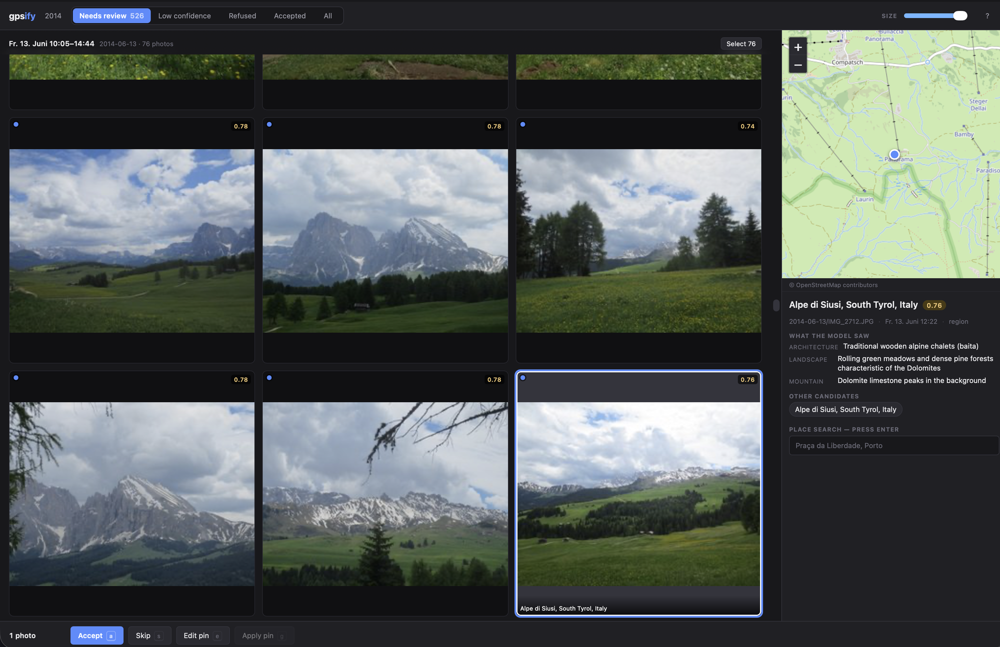

# gpsify

[](https://github.com/dariuszparys/gpsify/actions/workflows/ci.yml)
[](LICENSE)
[](https://www.python.org/downloads/)

Visual geolocation of untagged photos. gpsify proposes a location from pixels, shows its work, and writes GPS **only after a human accepts**.

This repository is a macOS-first, local-first CLI plus a localhost review UI. The safety rails it will not cross — and the frozen SQLite schema behind them — are in [`docs/decisions.md`](docs/decisions.md).



## Status

**Alpha.** The whole pipeline works end to end: `ingest → propose → review → apply → undo`, two vision providers, a Lightroom-style review grid, and full-file undo. Expect rough edges in error messages and in formats outside the JPEG/HEIC happy path.

What it will not do, by design: **write GPS without a stored human decision.** There is no confidence threshold that unlocks an automatic write.

macOS-first (HEIC, Homebrew `exiftool`). Linux is best-effort. Windows is not supported.

## What this sends where

gpsify is local-first, not local-only. Running `propose` sends your photos to a third-party AI provider. Specifically:

| Leaves your machine | To whom | What exactly |
| --- | --- | --- |
| A resized **1280 px JPEG preview** of each untagged photo, plus its **filename** and any `--hint` you pass | xAI or Google, whichever `--provider` you pick | Never the original file, never the RAW container, never the rest of the path |
| The **place name** the model guessed (e.g. `Ponte de Dom Luís I, Porto`) | Your configured geocoder — public Nominatim by default | Never a house-address-shaped string, never a privacy-flagged or refused result |

Nothing else. No telemetry, no analytics, no crash reporting. The review UI binds `127.0.0.1` and serves thumbnails by opaque `photo_id` — originals are never mounted, and there is no LAN flag. Job data, previews, and backups stay in `~/.gpsify`.

On retention: xAI calls set `store=False` on every request. **Gemini has no per-request equivalent** — see [Gemini retention](#gemini-retention-use-a-billed-key) before pointing a free-tier key at real photos.

### It costs real money

One paid vision call per photo. There is no confirmation prompt before spending.

| Album size | `xai` / `grok-4.6` | `gemini` / `gemini-2.5-flash` |
| --- | --- | --- |
| 100 photos | ~$0.60–$1.50 | ~$0.18 |
| 2,000 photos | ~$12–$30 | ~$3.60 |

Controls for previewing or limiting a run:

- `GPSIFY_DRY_RUN=1` — blocks every paid call and every write; prints what it *would* do.
- `--dry-run` — the same, per command.
- `--limit N` — cap how many photos this run proposes.
- `--max-cost USD` — stop scheduling photos when this run's reported usage reaches
  the estimated USD threshold. Available on `run` and `propose`; budgeted runs
  serialize calls regardless of `--concurrency`. The final call can overshoot.
  Pricing is an estimate, and failed/refused requests without usage are not counted,
  so this is not a hard provider billing cap. Remaining photos can be resumed.

The running `est_usd` total prints as `propose` goes, and `gpsify status --json` reports cumulative spend for the life of the job. Reported token usage is
checkpointed immediately after each successful vision response, before geocoding.

## Requirements

- Python 3.12+
- [`exiftool`](https://exiftool.org) on `PATH` — `brew install exiftool`. Treat this as required, not optional; see below.

### Why `exiftool` is effectively required

JPEG-only folders work with the Pillow/Piexif fallback. Ingest refuses folders
containing HEIC, RAW, or PNG when ExifTool is unavailable: unreadable metadata
must never be treated as proof that a photo has no GPS. Install ExifTool and
re-run ingest before proposing those formats.

Run `uv run gpsify doctor` to check ExifTool, HEIC preview support, the selected
provider's API key, and geocoder configuration. It makes no network calls and
never prints credentials. Exit code 1 means a capability or configuration is missing.

## Install

```bash
brew install exiftool
```

[uv](https://docs.astral.sh/uv/) is the only supported workflow for the Python side. It provisions the Python pinned in `.python-version` and installs the exact versions in `uv.lock`.

```bash
uv sync --extra heic
uv run gpsify --help
```

`heic` (`pillow-heif`) is the one optional runtime extra and covers HEIC **decode** for previews and vision. Omit `--extra heic` to match CI: JPEG/PNG/RAW still work and HEIC preview is `skipped_unsupported`.

## Quickstart

Get a key from [xAI](https://console.x.ai) (or [Google AI Studio](https://aistudio.google.com/apikey) for `--provider gemini`), then:

```bash
export XAI_API_KEY=...
export NOMINATIM_CONTACT=you@example.com    # required by OSMF policy, see below

# See what it would do and what it would cost — spends nothing:
GPSIFY_DRY_RUN=1 uv run gpsify run ~/Pictures/my-album

# For real, capped at 20 photos:
uv run gpsify run ~/Pictures/my-album --hint "weekend in Porto, 2019" --limit 20
```

`run` chains `ingest → propose → review` and opens the review grid in your browser. Nothing is written to a photo until you review the proposals and then run `apply`:

```bash
uv run gpsify apply ~/Pictures/my-album      # writes copies, originals untouched
```

## Configuration

Secrets stay out of git. Copy [`.env.example`](.env.example) to `.env` or export in the shell:

| Name | Default | Purpose |
| --- | --- | --- |
| `XAI_API_KEY` | unset | Key for `--provider xai` (required from `propose` onward) |
| `GEMINI_API_KEY` | unset | Key for `--provider gemini` |
| `NOMINATIM_CONTACT` | unset | Email-shaped contact for public Nominatim |
| `GPSIFY_MODEL` | `grok-4.6` | Vision model for `--provider xai` |
| `GPSIFY_GEMINI_MODEL` | `gemini-2.5-flash` | Vision model for `--provider gemini` |
| `GPSIFY_REASONING` | `low` | `low` \| `medium` \| `high` (`xhigh` is rejected) |
| `GPSIFY_TIMEOUT_S` | `600` | Client timeout (minimum 120) |
| `GPSIFY_VISION_PROVIDER` | `xai` | `xai` \| `gemini`; default for `--provider` |
| `GPSIFY_DATA_DIR` | `~/.gpsify` | Config, job index, and job trees |
| `GEOCODER_URL` | public Nominatim search | Switch geocoder without a code change |
| `GPSIFY_GEOCODER` | `nominatim` | Geocoder client to use |
| `GEOCODE_LANG` | `en` | Language for geocoder results |
| `MAP_TILE_URL` | OpenStreetMap tiles | Point the review map at your own tile server |
| `GPSIFY_DRY_RUN` | unset | `1` blocks every paid call and every write — see [above](#it-costs-real-money) |

Optional `~/.gpsify/config.toml` (mode `0600` on a real machine):

```toml
nominatim_contact = "you@example.com"
geocoder_url = "https://nominatim.openstreetmap.org/search"
geocoder = "nominatim"
map_tile_url = "https://tile.openstreetmap.org/{z}/{x}/{y}.png"
geocode_lang = "en"

[vision]
provider = "xai"           # or "gemini"
model = "grok-4.6"         # used when provider = "xai"
gemini_model = "gemini-2.5-flash"
reasoning_effort = "low"
timeout_s = 600
```

`NOMINATIM_CONTACT` is **required** before gpsify will call the public Nominatim instance — the [OSMF usage policy](https://operations.osmfoundation.org/policies/nominatim/) requires an identifiable contact. It is not needed if you point `GEOCODER_URL` at your own instance.

Environment variables override the TOML file. `GPSIFY_DRY_RUN` is the exception: it is read straight from the environment and has no TOML key, so it can never be left on by a config file you forgot about.

## Vision providers

Both providers send the same `PROMPT_V1` and are held to the same `VisionGuess`
schema, so runs are comparable. Each reads only its own key — selecting one
provider never falls back to the other's credentials.

| | `xai` (default) | `gemini` |
| --- | --- | --- |
| Key | `XAI_API_KEY` | `GEMINI_API_KEY` |
| Default model | `grok-4.6` | `gemini-2.5-flash` |
| Reasoning knob | `reasoning_effort` | `thinkingConfig.thinkingBudget`, mapped from the same `low`/`medium`/`high` |
| ~Cost per photo | ~$0.006–$0.015 | ~$0.0018 |
| No-retention | `store=False` on every call | **key-tier property — see below** |

```bash
export GEMINI_API_KEY=...
uv run gpsify propose <job_id> --provider gemini
```

`gemini-2.5-flash` is the default because
[`docs/research/vision-model-selection.md`](docs/research/vision-model-selection.md)
ranks it second on every public photo-geolocation benchmark it surveys
(GeoArena, EarthWhere, GeoRC) at roughly 3–8× lower list cost than `grok-4.6`.
Set `GPSIFY_GEMINI_MODEL=gemini-2.5-pro` for the accuracy ceiling — first on
those same boards, at roughly Grok-like spend.

### Which model — measure, don't read

The research note ranks `gemini-2.5-flash` on *other people's* photos. To settle
it on yours, `scripts/bakeoff.py` scores any set of models against photos whose
GPS you already have — the album's own EXIF is the answer key:

```bash
uv run python scripts/bakeoff.py ~/Pictures/my-album \
    --model xai:grok-4.6 \
    --model gemini:gemini-2.5-flash \
    --model gemini:gemini-2.5-pro \
    --limit 20 --out bakeoff.json
```

Every model sees the byte-identical 1280 px preview, its place name goes through
the normal geocode path, and the distance from that pin to the photo's real
coordinates is the score. Output is Acc@1/25/200/750 km, median error, refusal
rate, observed token profile, and real dollars per photo. It writes no GPS and
mutates nothing; `GPSIFY_DRY_RUN=1` prints the plan and spends nothing.

One vision call per photo per model, so start with `--limit`.

### Gemini retention: use a billed key

Gemini has **no per-request `store=False`**. Retention is a property of the key's
tier, which the API does not report, so gpsify cannot check it for you and
prints a warning on every `--provider gemini` run. On the free tier Google may
use prompts and images to improve its products; billing-enabled keys are
excluded. Enable billing on the key before pointing it at real photos.

## CLI

```text
gpsify doctor
gpsify run <folder> [--hint TEXT] [--recursive] [--limit N] [--max-cost USD] [--provider xai|gemini]
                    [--port 8765] [--dry-run] [--no-review]
gpsify ingest <folder> [--hint TEXT] [--recursive] [--relocate JOB_ID]
gpsify propose <job> [--limit N] [--max-cost USD] [--dry-run] [--no-context] [--provider xai|gemini] ...
gpsify geocode <job> [--limit N] [--dry-run] [--geocode-uncached-max N]
gpsify review <job> [--port 8765]
gpsify decide <job> --photo ID --action accept|skip|accept_edited [--lat --lng]
gpsify apply <job> [--out DIR] [--in-place] [--dry-run]
gpsify undo <job> [--photo PATH]
gpsify skip <job> --all-low [--yes]
gpsify status [job] [--json]
gpsify clean <job>
```

[Quickstart](#quickstart) covers the one-command path. `run` chains `ingest` → `propose` → `review`; `--no-review` stops after propose. It never writes GPS — only `apply` does.

The staged commands still work, and `ingest` still prints the `job_id`:

```bash
uv run gpsify ingest ~/Pictures/my-album --hint "weekend in Porto, 2019"
uv run gpsify propose ~/Pictures/my-album
uv run gpsify review ~/Pictures/my-album
```

### Job handles

`<job>` above is a **job UUID, a folder path, or `last`** — you never have to copy a
UUID. A folder resolves through the global index (`~/.gpsify/gpsify.sqlite`) by the
same canonical path `ingest` registered; `last` is the most recent ingest. Because the
resume key covers `{recursive: bool}`, one folder ingested both flat and `--recursive`
holds two jobs — gpsify then takes the most recent and says which it picked:

```text
$ gpsify status ~/Pictures/my-album
2 jobs share this folder; using the most recent: 9f060a67-… (recursive)
```

A UUID whose `job.sqlite` is on disk stays addressable even if its index row is gone,
so a lost index orphans nothing. `ingest --relocate JOB_ID` is the one place that still
needs a literal UUID: it rebinds a job to a new path, so resolving it *by* path would
be circular.

Undo checks the destination against the recorded post-write hash before restoring
or deleting it. A later edit is preserved and reported as `dest_diverged`; modified
RAW copies are also preserved. Conflicts keep their receipts available for retry.

`apply` with no flags writes copies under `~/.gpsify/jobs/<id>/copies/`. `--in-place` requires `--i-mean-it` or a TTY confirm.

## Review UI

`gpsify review <job>` (or the tail of `gpsify run`) serves a loopback-only grid at
`127.0.0.1:8765`. Nothing it does writes a file — closing the tab writes nothing, and
only `gpsify apply` touches a photo.

Photos are grouped the way they were shot: same folder, capture times within 45 minutes
(K9). A group header reads `Fri 12 Jul · 09:10–09:28 · album root · 7 photos`, and a
group with no capture times is flagged `⚠ No capture time` — those are the ones the
apply caps exist to protect.

Two actions look similar and are not:

| | What it does | Capped? |
| --- | --- | --- |
| **Accept** (`a`) | Every selected photo keeps its **own** proposal pin | No — nothing is copied between photos |
| **Apply pin** (`g`) | **One** photo's pin is copied onto the rest of the selection | Yes — K9's caps |

Apply-pin demands a typed confirmation when the batch is over 30 photos, when every
target lacks a capture time, or when more than 25% of them do. The server re-checks
that regardless of what the UI decided, and an id outside the `proposed` candidate set
is rejected rather than silently dropped.

Keyboard: arrows or `j`/`k` move · `Space` full preview · `⇧`-click ranges ·
`⌘`/`Ctrl`-click toggles · `⌘`/`Ctrl A` selects all · `a` accept · `s` skip ·
`e` edit pin · `g` apply pin · `1`–`5` filters · `?` the full list.

Place search geocodes **on Enter only** — never as you type (OSMF policy, K10). Leaflet
is vendored under `static/vendor/`, so the page itself needs no CDN; map tiles still
come from `map_tile_url`, which you can point at a local tile server.

### When propose stops at the geocoder cap

The geocoder is the only automatic pin source, so a `propose` run that hits the
public-Nominatim uncached cap leaves proposals at `pin_source=none` — the vision
work is done, but a bare `accept` has no coordinate to copy. `gpsify geocode`
finishes just that half against the current `geocoder_url`, re-using the guesses
already stored. It never calls a vision provider, so it costs nothing:

```bash
uv run gpsify geocode <job> --dry-run          # how many uncached lookups are left?
uv run gpsify geocode <job_id> --geocode-uncached-max 200
```

`geocoder_url` must point at a **Nominatim-shaped** endpoint. `NominatimGeocoder`
is the only client implemented, so a self-hosted Nominatim works, but Photon,
Mapbox, and Google do not — their responses parse to zero hits, which the
pipeline records (and caches) as a miss rather than an error. A few hundred
lookups at the built-in 1 rps is well inside personal use of the public
instance; a self-hosted Nominatim switches the cap off entirely.

## Limitations

- **A wrong pin is possible and expected.** Vision geolocation is a guess. gpsify is built around that: it shows the model's own coordinate next to the geocoder's, ranks its confidence, and makes you accept. Do not batch-accept without looking.
- **`exiftool` is required for HEIC, RAW, and PNG metadata.** Ingest refuses those formats when it is missing; JPEG-only fallback remains available.
- **RAW is never rewritten.** RAW photos get a sibling `.xmp` sidecar; the pixel data is never touched. Your RAW converter has to read sidecars for the tag to show up.
- **Photos.app libraries are refused.** gpsify will not open a `*.photoslibrary` bundle. Export first.
- **The geocoder must be Nominatim-shaped.** A self-hosted Nominatim works; Photon, Mapbox, and Google do not.
- **Public Nominatim is rate-limited and capped** at 50 uncached lookups per run, by policy. Large albums will need `gpsify geocode` passes or your own instance.
- **macOS-first.** Linux is best-effort; Windows is not supported.
- **Not on PyPI.** Install from a clone with `uv`.

## Tests

**GitHub Actions is the source of truth** for CI. The workflow runs `uv sync --locked` then `uv run pytest --disable-socket --allow-unix-socket` with `GPSIFY_DRY_RUN=1`. Unix sockets are allowed so asyncio/aiosqlite can create an event loop; TCP/UDP stay blocked. The Ubuntu job covers dependency fallback paths. The macOS job installs ExifTool
and HEIC support and also runs Chromium integration tests. No live AI or geocoder
calls occur; write tests use temporary photos.

Locally:

```bash
uv run pytest --disable-socket --allow-unix-socket -q
```

Browser tests run the real review server on loopback with generated photos:

```bash
uv run playwright install chromium
uv run pytest browser_tests -q
```

HEIC and live RAW-extract tests skip when `pillow-heif` / `exiftool` are missing.

## License

[MIT](LICENSE) — Copyright (c) 2026 Dariusz Parys

### Third-party

- [Leaflet](https://leafletjs.com) 1.9.4 is vendored under [`src/gpsify/review/static/vendor/`](src/gpsify/review/static/vendor/) so the review UI needs no CDN. BSD-2-Clause, (c) 2010-2023 Volodymyr Agafonkin, (c) 2010-2011 CloudMade — [full license text](src/gpsify/review/static/vendor/LICENSE-leaflet.txt).
- Map tiles and geocoding default to [OpenStreetMap](https://www.openstreetmap.org/copyright) — © OpenStreetMap contributors, [ODbL](https://opendatacommons.org/licenses/odbl/). The review UI displays this attribution, and gpsify follows the [OSMF Nominatim usage policy](https://operations.osmfoundation.org/policies/nominatim/): identifiable User-Agent, ≤1 request per second, results cached, no typeahead, and a per-run cap on uncached lookups.
- [`exiftool`](https://exiftool.org) by Phil Harvey is an external dependency, not bundled.
