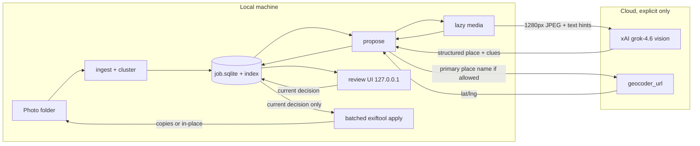
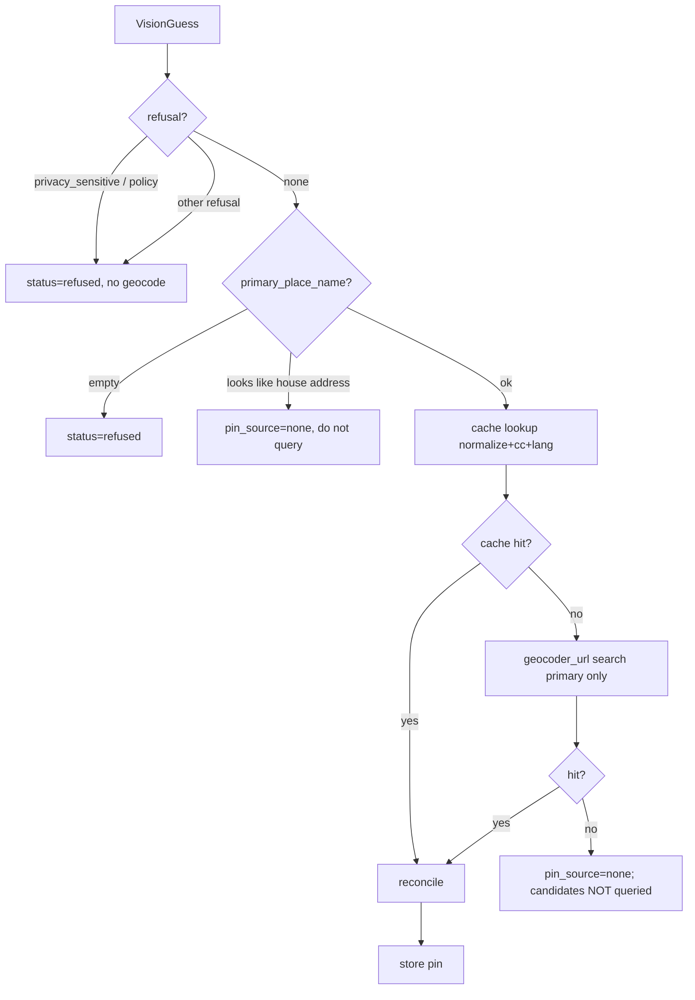

# gpsify — Visual Geolocation of Untagged Photos

| Field | Value |
| --- | --- |
| **Author** | gpsify |
| **Date** | 2026-08-12 |
| **Status** | Draft |
| **Audience** | Implementers of the v1 prototype |
| **Repo** | `/Users/dariuszparys/src/personal/gpsify` (greenfield; no code yet) |
| **Platform** | **macOS-first** personal tool (HEIC, `exiftool` via Homebrew, Time Machine). Linux is a best-effort secondary; Windows is out of v1. |

---

## Overview

Older cameras, social-media exports, and privacy-scrubbed files often have no `GPSLatitude` / `GPSLongitude`. Humans can sometimes infer location from architecture, signs, language, vegetation, and road markings; modern vision models can do the same with uneven accuracy. A wrong pin is worse than no pin, so **gpsify does not restore GPS automatically**. It proposes a location, shows its work, and writes GPS only after a human accepts.

v1 is a **macOS-first, local-first CLI + localhost review UI**. The user points it at a folder of JPEG, HEIC, PNG, and RAW files. It skips already-tagged files, sends a resized, orientation-corrected JPEG preview to a vision model (never the RAW container), geocodes the *place name* (never trusting the model's raw lat/lng as the sole source), and presents a map pin with a UI rank and clues. Accept records a **decision**; only `gpsify apply` writes tags, onto copies by default. JPEG/HEIC get in-file EXIF+XMP; PNG gets in-file XMP; **RAW gets an XMP sidecar only** (pixel data is never mutated). Proposals and decisions live in a local job store so tagging is undoable.

```text
folder in → vision model → geocode place → map pin + UI rank → decision → write GPS on apply
```

---

## Background & Motivation

### Current state

The workspace is empty. There is no stack, no schema, and no prior implementation. This document is the first artifact.

Typical personal libraries on macOS mix:

- JPEGs from phones that already have GPS (must be left alone).
- JPEGs / HEICs from older cameras, WhatsApp, Instagram, or "remove location" exports.
- RAW (CR2/NEF/DNG/ARW at minimum) that must never have pixel data mutated; GPS goes in an XMP sidecar.
- Photos.app libraries (`.photoslibrary` bundles) that **must not** be ingested as a folder.

A 200–2,000 photo vacation folder is the design load. Processing must be batch-native; review must be map-native.

### Why a hybrid pipeline

Published numbers (as of 2026) are uneven and travel-biased:

| Source | What it measures | Headline |
| --- | --- | --- |
| IMAGEO-Bench ([arXiv:2508.01608](https://arxiv.org/abs/2508.01608)) | Gemini 2.5 Pro on GeoGuessr-style street photos (Dataset-GSS) | 92.4% country; median 4.2 km |
| McAfee travel-photo test (July 2026) | Qwen3-VL 30B **local** | city+country named 91% of the time (travel-biased) |
| PIGEON / PIGEOTTO (CVPR 2024) | Street View frames | >40% within 25 km |
| Google Lens / visual search | Image *match*, not reasoning | Often wins on obscure places |

A vision LLM is good at *reasoning from clues* and producing a place name. It is bad at emitting a trustworthy coordinate pair. A geocoder is the opposite. Specialist geo models and reverse-image search can later add street-level precision. Human confirmation is the last gate.

Existing geotaggers (GeoSetter, ExifTool GUI, DigiKam, `osxphotos`) already write GPS well. They do not *propose* a location from pixels. gpsify exists for that missing step; it is not a catalog replacement.

### Pain points this product removes

1. Manually dropping pins in Photos / Lightroom for hundreds of untagged shots.
2. Blind trust of an LLM lat/lng that lands in the ocean or the wrong continent.
3. Silent cloud upload of a full photo library.
4. Irreversible EXIF writes with no proposal history.

---

## Goals & Non-Goals

### Goals (v1)

- Ingest a folder of JPEG, HEIC, PNG, and RAW photos; skip files that already have GPS; refuse Photos.app library bundles.
- Call a **vision** model (not a text-only LLM) with a resized, orientation-corrected JPEG preview plus optional album / user hints. Never upload a RAW container.
- For RAW: extract an embedded preview for vision; if none is usable, `skipped_no_preview`. On apply, write an **XMP sidecar** next to the dest RAW; never develop or rewrite the RAW.
- Return a structured proposal: place, candidates, clues, granularity, model confidence, refusal.
- Geocode the *primary* place name (candidates only on miss or user click); reconcile with any model-supplied coordinates.
- Review UI: thumbnail, pin, UI rank, clues, accept / edit-pin / skip / apply-to-cluster (explicit photo ids).
- Write GPS only on `apply`, and only from the **current decision** row. Default write path is **non-destructive** (copies).
- Persist job state, proposals, decisions, and write receipts locally so writes are undoable.
- Cost-conscious: long-edge resize to 1280 px before any network call; `reasoning_effort=low`; `store_messages=False`.
- Privacy-conscious: localhost only; no LAN bind in v1; no silent library upload; no sharing.

### Non-goals (v1)

- Automatic GPS write with no human in the loop.
- Finding a private individual's home from a window selfie or similar ("locate this person"). Landmark and travel photos are in-scope; stalking is out.
- Phone / iOS / Android app.
- RAW develop / convert / demosaic. Catalog integration (Lightroom, Photos.app library mutation) or cloud sync. RAW in v1 is preview-extract + XMP sidecar only.
- Reverse image search, Street View matching, GeoCLIP, or PIGEON.
- Multi-user, remote server, accounts, or LAN-exposed review UI.
- Perfect street-level accuracy on generic suburbs, forests, beaches, night crops, or indoor parties.
- Autocomplete against the public Nominatim instance.

---

## Key Decisions

| # | Decision | Rationale |
| --- | --- | --- |
| K1 | **Python 3.12+ CLI + localhost review UI**, not Electron/Tauri and not CLI-only | Review needs a map pin. Python owns EXIF, HEIC decode, Pillow, Pydantic, and SQLite. A 127.0.0.1 Starlette app plus Leaflet is enough for a personal tool; Electron/Tauri adds packaging cost with no product gain in v1. Pure CLI cannot show a pin. |
| K2 | **SpaceXAI (`grok-4.6`) is the default vision provider; Gemini is the second** | User decision 2026-08-12: Grok only for v1 dogfood. Gemini landed post-v1 as PR 10 (`--provider gemini`, `GEMINI_API_KEY`, default `gemini-2.5-flash`) behind the same `VisionProvider` protocol and the same `PROMPT_V1`/`VisionGuess` contract. Grok stays the default; neither provider reads the other's key. |
| K3 | **Never trust model lat/lng alone**; geocode the place name | Models hallucinate coordinates. The configured geocoder converts a named place to a real point. Disagreement is shown, not silently averaged. |
| K4 | **Human confirmation is mandatory**; no auto-write, even at high UI rank | A wrong pin is worse than no pin. |
| K5 | **Non-destructive by default**: `gpsify apply <job_id>` writes copies to `~/.gpsify/jobs/<id>/copies/<relpath>`. `--out DIR` overrides that dest. `--in-place` is explicit and mutually exclusive with `--out`. | Originals stay untouched unless the user opts in. Omitting both flags is not a usage error — dest is the job `copies/` tree, and `status` prints it. |
| K6 | **JPEG first-class (EXIF+XMP); PNG XMP-in-file; HEIC decode + EXIF+XMP; RAW in v1 via preview + XMP sidecar** | User decision 2026-08-12. xAI accepts only jpeg/png, so RAW is never uploaded. Propose from an embedded preview JPEG; no usable preview → `skipped_no_preview`. Apply never mutates RAW bytes. |
| K7 | **`exiftool` is the write engine**, invoked in **batches**; Piexif is JPEG-only test fallback | `exiftool` is the interoperability gold standard. Per-file process spawn will miss the ingest/apply latency targets. Do not reimplement GPS IFD packing. |
| K8 | **SQLite job store under `~/.gpsify/jobs/<job_id>/` plus a required global index** | One job = one folder ingest. The index (`~/.gpsify/gpsify.sqlite`) maps resume keys → `job_id`. Undo, resume, and review do not depend on sidecars next to originals. |
| K9 | **Time + folder clustering in v1**; no visual embeddings | Cheap and explainable. Apply-to-cluster is gated (explicit ids, `proposed` only, size/timestamp caps) so one wrong church cannot poison 400 undated exports. |
| K10 | **Public Nominatim is interactive + cached unique strings only**, not an unbounded bulk API | OSMF policy forbids autocomplete, requires identifiable UA + attribution, discourages bulk, and requires apps to switch geocoder without a software update. `geocoder_url` in config is the switch. |
| K11 | **`job_id` is a UUID printed once**; resume is by index, not by guessing | Re-ingest of the same canonical root + options upserts; a new path is a new job unless `--relocate`. |
| K12 | **`apply` reads only the current `decision` row** (never `proposal.pin_*`). `add_decision` may copy the proposal pin **at accept time** and must persist finite lat/lng for every writeable action. | Proposal pins are suggestions. The human decision is the write contract. Exactly one `current=1` decision per photo. Null-coord accepts are rejected, not written. |
| K13 | **Every xAI image call sets `store_messages=False` / `store=False` and an explicit `reasoning_effort`** | Responses API stores conversations 30 days by default; image-understanding docs warn requests may fail unless storage is off. `grok-4.6` reasoning cannot be disabled and defaults to `"high"` — omitting the knob silently explodes cost/latency. `xhigh` exists and is out of v1. |
| K14 | **macOS-first**; refuse `*.photoslibrary` roots | First albums are iPhone HEIC and/or DSLR RAW. Mutating a Photos.app bundle is a non-goal and will corrupt the library. |
| K15 | **Undo JPEG/HEIC/PNG from a full-file backup taken before `exiftool`. Undo RAW by deleting or restoring the XMP sidecar only.** | Never copy a multi-ten-MB RAW as an undo blob. Never hardlink. Never `-overwrite_original` on a RAW. |
| K16 | **Review UI binds `127.0.0.1` only**; no `--i-understand-lan` in v1 | A LAN bind with no auth would publish thumbs and place guesses on the local network. Loopback is the trust boundary. |
| K17 | **RAW write is sidecar-only** (`foo.CR2` → `foo.xmp`). Copies mode copies the RAW and writes the sidecar next to the copy. `--in-place` writes only the sidecar next to the original. | User decision 2026-08-12. Lightroom reads XMP sidecars; rewriting RAW containers is unsafe and unnecessary. |

---

## Proposed Design

### Recommended stack

| Layer | Choice | Why |
| --- | --- | --- |
| Language | Python 3.12+ on macOS | EXIF, Pillow, HEIC, Pydantic, pytest. One runtime for CLI and review server. |
| Packaging | `pyproject.toml` + **`uv` only** (`uv.lock` committed, Python pinned in `.python-version`) as `gpsify` console script | One workflow for dev and CI; reproducible resolution. Dev tooling in `[dependency-groups]`, `heic` the one runtime extra. |
| License | **MIT** (PR 1) | Personal prototype; permissive, no decision to defer. |
| CLI | `typer` | Subcommands, `--help`, shell completion. |
| Config | `pydantic-settings`, env + `~/.gpsify/config.toml` (`0600`) | Required: `XAI_API_KEY`, `nominatim_contact` (email). |
| Vision HTTP | Official `xai-sdk` (primary) or OpenAI SDK at `https://api.x.ai/v1` | [xAI quickstart](https://docs.x.ai/developers/quickstart). `chat.parse(VisionGuess)` with `store_messages=False`. |
| Images | Pillow + `pillow-heif` (optional extra `heic`) | `ImageOps.exif_transpose` before resize; HEIC primary still only. |
| EXIF read | Batched `exiftool -j -fast -n` (chunks of 200); else Pillow / Piexif per file | Meets the 2,000-file ingest target. Piexif is JPEG-only. |
| EXIF write | `exiftool -stay_open True` or `-@ argfile`; required for apply | Correct GPS IFD + refs + XMP. |
| Geocode | Configurable `geocoder_url`; default public Nominatim | Switch to Photon / self-hosted Nominatim / Mapbox without a code change. |
| Persistence | **`aiosqlite`** (or `asyncio.to_thread` around stdlib) + WAL | Propose is asyncio; a blocking `sqlite3` call on the event loop will stall vision. One writer connection per job. |
| Review UI | Starlette + a single static `index.html` (Leaflet, no React build) | Map pin, drag, keyboard. Bind **127.0.0.1 only**. |
| Map tiles | OSM via Leaflet (or a tile URL in config) | ODbL attribution required in the UI chrome. |
| Tests | pytest, respx/httpx mock, tmp_path fixtures, GitHub Actions (no network) | No live GPS writes; no live API in CI. |

**Rejected for v1:** Electron/Tauri (packaging tax), Swift/AppKit (slower to iterate), Next.js (overkill), Photos.app automation (fragile), LAN-exposed UI.

### Proposed directory layout

Greenfield — nothing of this exists yet:

```text
gpsify/
  pyproject.toml
  README.md
  LICENSE                       # MIT
  .gitignore                    # .env, .venv, __pycache__, ~/.gpsify is outside the repo
  .github/workflows/ci.yml      # pytest, no network
  .env.example                  # XAI_API_KEY=  NOMINATIM_CONTACT=
  src/gpsify/
    __init__.py
    cli.py                      # ingest, propose, review, decide, apply, undo, skip, status, clean
    config.py
    types.py
    ingest.py                   # walk, classify, hash, cluster
    media.py                    # decode, exif_transpose, resize, RAW preview extract
    exif.py                     # batched exiftool read/write
    cluster.py                  # time+folder clusters (called from ingest)
    propose.py
    apply.py
    undo.py
    reconcile.py
    providers/
      base.py
      xai_grok.py
      gemini.py                 # post-v1 second provider (PR 10)
    geocode/
      base.py
      nominatim.py
      cache.py
    review/
      app.py
      static/index.html
      static/app.js
      static/style.css
    store/
      db.py                     # full schema v1
      repo.py                   # including add_decision(...)
      index.py                  # ~/.gpsify/gpsify.sqlite
  tests/
    conftest.py
    test_ingest.py
    test_exif.py
    test_cluster.py
    test_media.py
    test_propose.py
    test_geocode_reconcile.py
    test_apply.py
    test_review_api.py
    test_xai_flags.py
    fixtures/
      jpeg_with_gps.jpg
      jpeg_no_gps.jpg
      known_locations.json
```

No `scripts/smoke_folder.sh` in v1. Live checks live under `pytest -m live`. `scripts/bakeoff.py` landed post-v1 (PR 10): it spends real money on real API calls, so it is a script you run deliberately, never part of the test suite.

Local data (not in the repo):

```text
~/.gpsify/
  config.toml                   # mode 0600
  gpsify.sqlite                 # REQUIRED global job index (not optional)
  cache/
    geocode.sqlite
  jobs/
    <job_id>/
      job.sqlite
      previews/                 # 1280px JPEGs, created lazily
      thumbs/                   # 256px, created lazily
      backups/                  # full-file copies taken immediately before exiftool
      copies/                   # default dest for apply when --out is omitted
      logs/
        propose.log
```

Previews are the only image bytes that ever leave the machine. `gpsify clean <job>` deletes `previews/` and `thumbs/`; sqlite and backups stay.

### Config (`~/.gpsify/config.toml`)

```toml
# Required before any Nominatim call (propose geocode or review search).
nominatim_contact = "you@example.com"

# Switch geocoder without a software update (OSMF requirement).
# Examples:
#   https://nominatim.openstreetmap.org/search
#   https://photon.komoot.io/api
#   http://127.0.0.1:8080/search          # self-hosted Nominatim
geocoder_url = "https://nominatim.openstreetmap.org/search"
geocoder = "nominatim"                    # nominatim | photon | mapbox | google
map_tile_url = "https://tile.openstreetmap.org/{z}/{x}/{y}.png"
geocode_lang = "en"

[vision]
provider = "xai"
model = "grok-4.6"
reasoning_effort = "low"                  # low | medium | high; xhigh is rejected
timeout_s = 600                           # ≥ 120; xAI examples use 3600
```

`gpsify propose` and `gpsify review` **refuse to start** if `nominatim_contact` is missing or is not an email-shaped string, unless `geocoder` is `mapbox`/`google` (those use their own keys) or `geocoder_url` is loopback/self-hosted.

User-Agent for public Nominatim:

```text
gpsify/0.1 (personal; {nominatim_contact})
```

Stock HTTP-library UAs are forbidden.

### CLI surface

```text
gpsify ingest <folder> [--hint "weekend in Porto"] [--recursive] [--relocate JOB_ID]
       → prints job_id, counts (total / tagged / untagged / skipped / missing / clusters)
       → plus an `other:` line for any status the four buckets do not cover
         (a resumed job's proposed / refused / written photos), so a re-ingest
         of finished work never reports all zeros

gpsify propose <job_id> [--limit N] [--concurrency 3] [--dry-run] [--force]
                     [--no-context] [--provider xai|gemini]
                     [--geocode-uncached-max N]
       → --dry-run: no network, print planned calls + cache hits
       → --no-context: pixels only (no hint / folder / filename / siblings)
       → --provider: xai (default) | gemini; defaults to GPSIFY_VISION_PROVIDER
       → --geocode-uncached-max: public Nominatim uncached cap (default 50)
       → default (no --dry-run): vision + geocode; writes proposals; does not write GPS

gpsify geocode <job_id> [--limit N] [--dry-run] [--geocode-uncached-max N]
       → geocodes proposals left at pin_source=none; no vision call, no vision spend
       → --dry-run: no network; counts the distinct place names still needing an
         uncached lookup, i.e. what to pass to --geocode-uncached-max

gpsify review <job_id> [--port 8765]
       → opens http://127.0.0.1:8765  (loopback only; no LAN flag)

gpsify decide <job_id> --photo <photo_id> --action accept|skip|accept_edited [--lat --lng]
       → test/script seam over repo.add_decision; not the review UX
       → accept without --lat/--lng copies the current proposal pin (rejected if none)

gpsify apply <job_id> [--out DIR] [--in-place] [--dry-run]
       → writes GPS from the current decision only
       → no flags: dest = ~/.gpsify/jobs/<id>/copies/<relpath>  (not a usage error)
       → --out DIR: dest = DIR/<relpath>   --in-place: mutate source (exclusive with --out)

gpsify undo <job_id> [--photo PATH]
       → restores the full-file backup taken before exiftool

gpsify skip <job_id> --all-low [--yes]
       → preview the list; require --yes (or TTY confirm) before writing skip decisions

gpsify status [job_id] [--json]
gpsify clean <job_id>                   # delete previews/thumbs; keep sqlite + backups
```

Typical session:

```bash
export XAI_API_KEY=...
gpsify ingest ~/Pictures/porto-2019 --hint "weekend in Porto, 2019"
gpsify propose <job_id>
gpsify review <job_id>
gpsify apply <job_id>                  # copies → ~/.gpsify/jobs/<id>/copies/
# or: gpsify apply <job_id> --out ~/Pictures/porto-2019-tagged
```

`--dry-run` always means **no side effects that cost money or mutate photos**. For `propose`, that is no xAI call and no public Nominatim call (cache reads are allowed). For `apply`, print the would-be `exiftool` argfile and write nothing. There is no `--offline` flag; `--dry-run` covers it. Live propose is the default of `propose` without `--dry-run`.

### Architecture



Previews are **not** built at ingest. `propose` (and `review` thumbs) create them just-in-time so `propose --limit 10` does not materialize 2,000 JPEGs.

### End-to-end sequence

```mermaid
sequenceDiagram
  actor User
  participant CLI
  participant Index as gpsify.sqlite
  participant Store as job.sqlite
  participant Vision as xAI grok-4.6
  participant Geo as geocoder_url
  participant UI as Review UI
  participant EXIF as exiftool

  User->>CLI: ingest folder [--hint]
  CLI->>Index: lookup canonical(root)+options_hash
  alt existing job
    CLI->>Store: upsert photos, mark missing
  else new job
    CLI->>Index: insert UUID job_id
    CLI->>Store: create schema v1
  end
  CLI-->>User: job_id, counts

  User->>CLI: propose job_id
  CLI->>Store: reset stale proposing → pending
  loop each pending photo (concurrency 3)
    CLI->>CLI: lazy preview: exif_transpose, 1280, JPEG q85
    CLI->>Vision: store=False, reasoning_effort=low, timeout≥120s
    Vision-->>CLI: VisionGuess + usage
    alt refusal or privacy_sensitive
      CLI->>Store: status=refused, no geocode
    else named place
      CLI->>Geo: primary only, cache, ≤1 rps
      Geo-->>CLI: lat/lng
      CLI->>CLI: reconcile
      CLI->>Store: proposal current=1 + pin
    end
  end

  User->>CLI: review job_id
  CLI->>UI: bind 127.0.0.1
  User->>UI: accept / drag pin / skip / apply-cluster
  UI->>Store: add_decision current=1

  User->>CLI: apply job_id
  CLI->>Store: read current decision only
  CLI->>Store: upsert write_receipt pending
  CLI->>CLI: dest inspection first (GPS match → ok; even if --in-place hash ≠ ingest)
  CLI->>CLI: dest missing → copy (copy mode) or source_missing (--in-place)
  CLI->>CLI: dest half-written → restore backup
  CLI->>CLI: full-file backup before exiftool
  CLI->>EXIF: batched write on dest
  EXIF-->>Store: receipt ok/failed + written_sha256
```

### Job / session model

#### Job identity (K11)

- `job_id` = UUID4, printed once, used in every subsequent command.
- Global index table `job_index` in `~/.gpsify/gpsify.sqlite`:

```sql
CREATE TABLE job_index (
  job_id TEXT PRIMARY KEY,
  root_canonical TEXT NOT NULL,
  options_hash TEXT NOT NULL,
  created_at TEXT NOT NULL,
  last_ingest_at TEXT NOT NULL,
  UNIQUE(root_canonical, options_hash)
);
```

- `root_canonical` = `Path(folder).resolve()` string.
- `options_hash` = SHA-256 of the canonical JSON `{recursive: bool}` only. **`--hint` is not part of the resume key** (changing the hint updates `job.hint` and does not fork a job or delete proposals).
- Re-running `ingest` on the same resolved path + same `--recursive` **resumes** that `job_id`.
- A different resolved path is a **new job**. `--relocate OLD_JOB_ID` rebinds `root_canonical` after a folder move (v1 ships this; it is not deferred). Relocate matches existing rows by `sha256` and updates `path` / `relpath`.
- Two simultaneous ingests of the same key: the index `UNIQUE` constraint wins; the second command opens the existing job.

#### Re-ingest rules

| Event | Action |
| --- | --- |
| Same path, same sha256 | Keep row; refresh `mtime_ns` / `size`; keep proposals and decisions |
| Same path, **different sha256** | Reset status to `pending`; set `proposal.current=0` on old proposals; clear `decision.current`; do not delete history rows |
| Path gone from disk | Status `missing`; keep history; do not propose or apply |
| New path | Insert `pending` (or skip-class) |
| `--recursive` flipped | Different `options_hash` → **new job** (do not merge trees) |

#### Photo states

```text
discovered → skipped_has_gps
           → skipped_unsupported
           → skipped_unreadable
           → skipped_no_preview
           → pending
           → proposing
           → proposed | refused | error
           → accepted | accepted_edited | skipped_by_user
           → written | write_failed
           → undone
           → missing
```

`accepted` / `accepted_edited` / `skipped_by_user` are **denormalized mirrors of the current decision** (`decision.current=1`). They can be superseded before apply: a later skip replaces an accept (and vice versa). Last-write-wins on `decision.current`. After `written`, a new decision does not unwrite the file; the user must `undo` first.

#### Propose recovery and concurrency

- On every `propose` start: `UPDATE photo SET status='pending' WHERE status='proposing'` (crash repair).
- At most **one `propose` writer per job**. A pid lock file `jobs/<id>/propose.lock` (or `BEGIN IMMEDIATE` on a `locks` table) makes a second `propose` exit 2.
- `review` is **read + decision-write** only. WAL allows it during `propose`. Review must not run `apply`.
- `apply` takes the same exclusive lock as `propose`.
- Store access: one writer connection; readers allowed. Use `aiosqlite` or `asyncio.to_thread` so vision awaits do not block on disk.

Idempotency: a photo with a current `proposed`/`refused` row is not re-sent unless `--force`. Failed photos retry with exponential backoff (3 attempts: 2s / 8s / 30s) then `error`. HTTP client timeout is **`timeout_s` from settings (default 600, minimum 120)** — not the 5–60s library default. Retries apply to 429/5xx **and** timeouts.

Cluster states are derived: `open` while any member is `pending`/`proposed`; `reviewed` when every member is accepted, skipped, refused, written, or missing.

### Folder ingest

1. Resolve `folder`. If the path is or is inside a `*.photoslibrary` bundle, **exit 2** with a message to export originals first (K14).
2. Walk (non-recursive default; `--recursive` optional). Ignore `._*` AppleDouble, `.DS_Store`, `Thumbs.db`, and anything under `.gpsify/`. If a non-recursive walk finds **zero** files and the root holds subdirectories the recursive walk would descend into, **warn** `no files at top level; N subdirectories found — did you mean --recursive?`. A date-foldered library export (`originals/2014/2014-05-04/…`) otherwise reports a silent `total: 0` and reads as a missing feature. The walk still succeeds — this is a warning, not an error, and it never flips `recursive` on the user's behalf (that would fork the resume key).
3. Classify by extension (case-insensitive):
   - **v1 process (EXIF+XMP in-file write):** `.jpg`, `.jpeg`
   - **v1 process (XMP in-file write):** `.png`
   - **v1 decode-for-vision, EXIF+XMP in-file write via exiftool:** `.heic`, `.heif` (require `pillow-heif` + `exiftool`)
   - **v1 process (preview-for-vision, XMP sidecar write):** `.cr2`, `.cr3`, `.nef`, `.arw`, `.dng` required. `.raf`, `.orf`, `.rw2` same path, best-effort if a preview extracts.
   - **v1 skip:** video and everything else
4. Compute SHA-256 (streaming). Store `path`, `relpath` (relative to root), `mtime_ns`, `size`, `sha256`.
5. Read EXIF / XMP in **one batched `exiftool` invocation per 200 paths** (see [exif.py contract](#exifpy-contract-batched-readwrite)). For RAW also read a sibling `basename.xmp` if it exists.
   - If `GPSLatitude` and `GPSLongitude` are both present and parseable **in the file or in a sibling XMP sidecar** → `skipped_has_gps`. Do not send to the model. Do **use** the existing pin as cluster context for siblings.
   - Capture `DateTimeOriginal` (fallback `CreateDate` only; **do not** fall back to file mtime for clustering — mtime is stored but is not a capture time).
   - Capture `Make`, `Model`, `OffsetTimeOriginal`, `GPSImgDirection`, `GPSAltitude`, `Orientation`.
6. Build clusters (see below).
7. Upsert per [re-ingest rules](#re-ingest-rules). Persist and print a summary. The summary **accounts for every photo row**: `total` is the whole job, and any status outside the tagged / untagged / skipped / missing buckets is listed on the `other:` line. Re-ingesting a job whose photos are already `proposed` must not print four zeros.

Already-tagged files stay in the job as `skipped_has_gps` so the review UI can draw them as ground-truth pins on the cluster map.

**Live Photos / HEIC sequences:** decode the **primary still** only (`pillow-heif` default image). Do not send the video companion or burst frames.

**RAW preview extract (v1, K17):** never decode the sensor dump and never send the RAW to xAI. On first `propose` / thumb, try in order via `exiftool -b` (first non-empty result whose decoded long edge is ≥ 256 px):

1. `JpgFromRaw`
2. `PreviewImage`
3. `OtherImage`
4. `ThumbnailImage` only if nothing larger exists **and** long edge ≥ 256 px; otherwise `skipped_no_preview`

Then `exif_transpose` + resize to 1280/q85 as for JPEG. If every extract is empty or too small → status `skipped_no_preview`, no vision call. RAW files still participate in clustering (they usually have `DateTimeOriginal`); they are **not** eligible for cluster-apply (status is not `proposed`).

### Media pipeline

Normative rules:

1. **Lazy.** Ingest never writes `previews/` or `thumbs/`. `propose` builds a preview immediately before the vision call. `review` builds a thumb on first `GET /api/thumb/{id}` (and a preview on first `/api/preview/{id}` if missing).
2. **Orientation.** After decode, call `PIL.ImageOps.exif_transpose` (JPEG/PNG/extracted RAW preview) or the `pillow-heif` equivalent so `Orientation` is applied and then stripped from the preview. A sideways iPhone frame will otherwise hide signs/text from the model.
3. **Resize.** Long edge 1280 px, JPEG quality 85, 4:2:0. Never mutate the original file. Never send a RAW container.
4. **Identity.** After building a preview, re-hash the original and refuse to send if it no longer matches `photo.sha256`.

`--limit N` therefore hashes/reads EXIF for the whole folder at ingest (cheap, batched) but only decodes N previews at propose time.

### exif.py contract (batched read/write)

**Read (ingest, PR 3):**

```bash
exiftool -j -fast -n \
  -GPSLatitude -GPSLongitude -GPSLatitudeRef -GPSLongitudeRef \
  -DateTimeOriginal -CreateDate -OffsetTimeOriginal \
  -Make -Model -Orientation \
  -GPSImgDirection -GPSAltitude \
  -- FILE [FILE ...]
```

Chunk size 200 paths per process. If `exiftool` is missing, fall back to Pillow / Piexif **per file** (JPEG only) and skip HEIC GPS detection with a warning.

**Write (apply, PR 8):** use `exiftool -stay_open True -@ -` (or a single `-@ argfile` of all dests that share the same tag set). Do **not** spawn one process per photo. After the batch, re-read GPS for each dest (`-j -n`) and confirm haversine error < 1e-5 deg.

Illustrative per-file tag set (JPEG/HEIC) with `-n` **signed** decimals so `exiftool` infers the ref; still write refs explicitly for readers that ignore `-n`:

```bash
exiftool -n \
  -GPSLatitude=41.1456 -GPSLatitudeRef=N \
  -GPSLongitude=-8.6143 -GPSLongitudeRef=W \
  -GPSMapDatum=WGS-84 \
  -XMP:GPSLatitude=41.1456 -XMP:GPSLongitude=-8.6143 \
  -XMP-dc:Source=gpsify \
  -overwrite_original \
  "$dest"
```

### Vision prompt + structured output

**Provider defaults (SpaceXAI / xAI) — normative client contract (K13):**

| Item | Value |
| --- | --- |
| Env | `XAI_API_KEY` |
| Base URL | `https://api.x.ai/v1` |
| Model | `grok-4.6` (image + text → text; structured outputs; 500k context) |
| Image input | `jpg/jpeg` or `png`, max 20 MiB, `detail: "high"` |
| Call style | `xai_sdk` `chat.parse(VisionGuess)` **or** OpenAI-compatible with `response_format` JSON schema |
| Storage | **`store_messages=False`** (`xai-sdk`) / **`store=False`** (OpenAI-compatible) on **every** image call. The Responses API stores conversations **30 days by default**; image-understanding docs warn the request **may fail** unless storage is disabled. |
| Reasoning | **Always pass** `reasoning_effort` from settings. Default **`low`**. Allowed: `low`, `medium`, `high`. **`xhigh` is rejected** in v1. Omitting the parameter silently uses API default **`high`**. Reasoning **cannot be disabled** on `grok-4.6`. |
| Timeout | Client timeout = `timeout_s` (default **600**, minimum **120**). xAI examples use 3600; 5–60s HTTP defaults will flake. |
| Usage | Persist `usage.input_tokens`, `usage.output_tokens`, and **`usage.reasoning_tokens`** on the proposal row; feed them into the running USD estimate. |
| History | Do not continue a prior response id. Each photo is a fresh chat. |

The `xai_grok` wrapper **must refuse to send** if `store_messages`/`store` is not False or if `reasoning_effort` is missing. `tests/test_xai_flags.py` asserts this on the wrapper (not the fake provider).

Image payload: data URL `data:image/jpeg;base64,...` of the **resized, transposed** JPEG. Never a public URL of the user's photo. Never the 12 MP original.

**Provider defaults (Google Gemini) — normative client contract (PR 10):**

| Item | Value |
| --- | --- |
| Env | `GEMINI_API_KEY` (**billing-enabled**; see Storage below) |
| Base URL | `https://generativelanguage.googleapis.com/v1beta` |
| Model | `gemini-2.5-flash` (`GPSIFY_GEMINI_MODEL`); `gemini-2.5-pro` for the accuracy ceiling |
| Image input | inline base64 `image/jpeg`; whole request must stay under 20 MB, so the raw JPEG is capped at 14 MiB |
| Call style | `POST /models/{model}:generateContent`, key in the **`x-goog-api-key` header** — never `?key=`, which lands in proxy logs |
| Structured output | `generationConfig.responseMimeType = "application/json"` + `responseSchema`. Gemini's schema is an OpenAPI 3.0 subset: `to_gemini_schema` inlines `$ref`/`$defs`, collapses `anyOf: [T, null]` to `nullable`, drops `title`/`default`, and stamps `propertyOrdering`. |
| Storage | **No per-request flag exists.** Retention follows the key's tier, which the API does not report. Free-tier prompts and images may be used to improve Google products; billed keys are excluded. `propose` warns once per run and cannot verify it. |
| Reasoning | **Always pass** `thinkingConfig.thinkingBudget`, mapped from `reasoning_effort`: `low` 1024, `medium` 8192, `high` 24576, clamped per model family (2.5 Pro cannot think below 128 tokens; Flash caps at 24576). Omitting it lets the model choose and bill its own budget. `includeThoughts` is False. |
| Timeout | Same `timeout_s` as xAI (default 600, minimum 120). |
| Usage | `usageMetadata.promptTokenCount` / `candidatesTokenCount` / **`thoughtsTokenCount`** map onto `Usage`. Thinking tokens bill as output. |
| Prompt | Imports `PROMPT_V1` and `format_user_message` from `xai_grok`. A bake-off is only meaningful if both providers see the identical prompt. |

The `gemini` wrapper **must refuse to send** if `thinkingConfig.thinkingBudget` is absent, if `responseMimeType` is not `application/json`, or if `responseSchema` is missing. `tests/test_provider_plugin.py` asserts this on the wrapper (not the fake provider).

#### Pydantic schema (wire contract)

```python
from enum import Enum
from pydantic import BaseModel, Field

class Granularity(str, Enum):
    exact = "exact"          # identifiable POI / building
    street = "street"        # block / street
    neighborhood = "neighborhood"
    city = "city"
    region = "region"        # state / province / national park
    country = "country"
    unknown = "unknown"

class RefusalReason(str, Enum):
    none = "none"
    insufficient_evidence = "insufficient_evidence"
    indoor_generic = "indoor_generic"
    privacy_sensitive = "privacy_sensitive"   # private residence, identifiable person-home
    policy_refusal = "policy_refusal"
    not_a_photograph = "not_a_photograph"

class Clue(BaseModel):
    kind: str = Field(description="sign|language|architecture|vegetation|road|vehicle|text|skyline|other")
    text: str
    weight: float = Field(ge=0, le=1)

class Candidate(BaseModel):
    place_name: str
    country_code: str | None = Field(default=None, description="ISO 3166-1 alpha-2")
    admin1: str | None = None
    lat_hint: float | None = None
    lng_hint: float | None = None
    confidence: float = Field(ge=0, le=1)
    why: str

class VisionGuess(BaseModel):
    refusal: RefusalReason
    refusal_detail: str | None = None
    primary_place_name: str | None = None
    country_code: str | None = None
    admin1: str | None = None
    granularity: Granularity
    lat_hint: float | None = None
    lng_hint: float | None = None
    model_confidence: float = Field(ge=0, le=1)
    clues: list[Clue]
    candidates: list[Candidate]  # up to 3, best first; not geocoded unless primary misses
    used_album_hint: bool
    used_filename_hint: bool
```

`lat_hint` / `lng_hint` are **hints only**. The pipeline geocodes `primary_place_name` only (see below).

#### System prompt (normative intent)

Keep this in `providers/xai_grok.py` as a versioned constant (`PROMPT_V1`):

- You are geolocating a travel/landmark photograph for the owner of the photo.
- Look at visible evidence only: signs, language/script, architecture, vegetation, road markings, vehicles, skyline, weather/season consistency with the stated capture time.
- Return a specific named place you would type into a map search box (e.g. "Clérigos Church, Porto, Portugal"), not a prose paragraph. Prefer a landmark or city name. **Do not return a street address with a house number.**
- Give 1–3 candidates when uncertain. Prefer a correct city over a wrong street.
- If this appears to be a private home, hotel room, generic indoor party, or a close-up with no geographic signal, set `refusal` accordingly. Do **not** invent a neighborhood.
- Do not identify private individuals or infer a home address from a window, doorbell, or street number on a house.
- `lat_hint`/`lng_hint` are optional approximations; the place name is the source of truth.
- If an album hint or filename is provided, treat it as a prior, not as proof. Say whether you used it.

#### User message (assembled, not sent as a blob of secrets)

```text
Album hint (user-provided, optional): {hint}
Folder name: {folder_basename}
Filename: {filename}
Capture time (EXIF, may be wrong TZ): {datetime_original} {offset}
Camera: {make} {model}
Cluster siblings already proposed (max 8):
  - 2019-06-14T18:02 IMG_1041.jpg → Ribeira, Porto, PT (city, 0.74)
  - 2019-06-14T18:04 IMG_1042.jpg → Luís I Bridge, Porto, PT (exact, 0.88)
Already-tagged siblings in this cluster (max 4):
  - IMG_1038.jpg @ 41.1406, -8.6110
Task: infer where this photo was taken.
```

Filename and folder often leak the trip (`IMG_Rome_2019`). That is a feature for a personal tool. Do not send the rest of the path (`/Users/dariuszparys/...`).

**Wow demo vs useful product:** `gpsify propose --no-context` strips hint, folder, filename, and siblings so the model sees only the pixels. Default is the useful product (context on).

### Geocoding and coordinate reconciliation



#### Policy (K10)

Public `nominatim.openstreetmap.org` is **not** a bulk geocoding API ([OSMF Nominatim usage policy](https://operations.osmfoundation.org/policies/nominatim/)). v1 uses it only as:

1. **Interactive** place search in the review UI: **submit-on-Enter only**. Keystroke / typeahead / autocomplete is **forbidden**.
2. **Cached unique place strings** after propose: one request per *distinct* cache key, ≤ 1 req/s, single machine, personal use.

If a single `propose` run would need **more than 50 uncached** public-Nominatim lookups, **stop geocoding**, keep remaining pins at `pin_source=none`, print a warning, and tell the user to set `geocoder_url` to Photon / self-hosted Nominatim / Mapbox or re-run with `--geocode-uncached-max N`. This is the documented bulk exception: a typical cached Rome weekend is tens of lookups; a 2,000-photo world tour on a cold cache is the wrong workload for the donated public instance.

`geocoder_url` (and `geocoder`) **must** be switchable in config without a software update.

**Do not submit personal data.** Never geocode when `refusal` is `privacy_sensitive` or `policy_refusal`. Never geocode a string that matches a house-address heuristic (`^\d+\s+\S+` plus a street-type token, or an obvious "12 Oak Street, …" pattern). Those proposals stay `pin_source=none` for manual map drop.

**Geocode primary only.** Do not geocode the up-to-3 candidates during `propose`. The review UI geocodes a candidate when the user clicks it (same cache, same 1 rps).

#### Filling pins the cap left behind (`gpsify geocode`)

The geocoder is the only automatic pin source, so a run that stops at the uncached cap leaves `pin_source=none` proposals that a bare `accept` cannot use (`add_decision` rejects them). Those photos are not lost, but the only ways forward would be pinning each by hand in the review UI or `propose --force`, which re-bills the vision call for every photo just to redo the geocoding.

`gpsify geocode <job_id>` is the geocode half of `propose` on its own. It reads the stored `VisionGuess` back out of `proposal.raw_json`, queries the primary place name against the *current* `geocoder_url`, and appends a new `proposal` row with the pin. No vision provider is constructed and no token is spent.

Normative rules:

- **Same gate as propose.** A photo is eligible only when `should_geocode` would have queried it, so a refusal, an empty primary, or a house-address string is never re-sent (K10 holds unchanged).
- **Never demotes.** A pin can only raise `ui_rank` (`geocode_score` 0.2 → 0.6/1.0), so a photo may move `refused` → `proposed` when the missing pin was what pushed it under the cutoff. It never moves the other way.
- **No churn.** A photo that stays unpinned (capped again, or a real miss) keeps its existing row; an identical proposal is never appended.
- **Zero token columns.** The appended row records what *this* pass cost, which is no vision tokens. The superseded row keeps the counts of the call that produced the guess, so a sum over `proposal` rows still totals real vision spend.
- **Cached misses stay missed.** The cache is keyed by place/country/lang, not by geocoder, so a name already recorded as a miss is not re-queried after switching `geocoder_url` until that cache entry is cleared. Names stopped by the cap were never queried and so were never cached.
- `--dry-run` reads the cache and opens no socket, reporting the number of distinct place names still needing an uncached lookup — the number to pass to `--geocode-uncached-max`.

#### `normalize(place)` (cache key)

Cache key = `normalize(place) + "|" + (country_code or "") + "|" + geocode_lang`.

```text
normalize(s):
  NFKC
  strip
  lower
  replace punctuation except comma with space
  collapse whitespace
```

#### Result type

```python
class GeoHit(BaseModel):
    query: str
    display_name: str
    lat: float
    lng: float
    boundingbox: tuple[float, float, float, float] | None  # S, N, W, E
    osm_type: str | None  # node|way|relation
    osm_id: str | None
    importance: float | None
    provider: str  # nominatim|photon|mapbox|google
```

#### Reconciliation rules

1. **Pin shown to the user = geocoder lat/lng**, not `lat_hint`.
2. If `lat_hint`/`lng_hint` exist, compute haversine distance `d` to the geocoder point.
3. Agreement threshold depends on claimed granularity:
   - `exact` / `street`: 500 m
   - `neighborhood`: 2 km
   - `city`: 15 km
   - `region`: 100 km
   - `country`: 500 km
4. If `d` is within threshold → `pin_source = geocoder`, `model_agree = true`.
5. If `d` exceeds threshold → `pin_source = geocoder`, `model_agree = false`, UI draws a second ghost pin at the model hint and a warning ("model and map search disagree by 42 km").
6. If geocode misses entirely → no default pin; user must search (Enter) or drop one. Do not fall back to `lat_hint` as the accepted coordinate unless the user explicitly clicks "use model coordinates".
7. Prefer results whose `display_name` country matches `country_code` when multiple hits exist. Prefer `osm_type=relation/way` for cities, `node` for POIs when granularity is `exact`.

Never average two disagreeing points.

### Confidence model and when to refuse

The model score is uncalibrated. v1 computes a **UI rank** (not a calibrated probability). It sorts the filmstrip and colors the badge. It is **not** used to auto-skip or auto-write.

```text
ui_rank = clip01(
    0.45 * clip01(model_confidence)
  + 0.20 * clip01(granularity_score)
  + 0.15 * clip01(clue_score)
  + 0.10 * clip01(geocode_score)
  + 0.10 * clip01(cluster_score)
)
```

| Term | Value |
| --- | --- |
| `granularity_score` | exact 1.0, street 0.85, neighborhood 0.7, city 0.55, region 0.3, country 0.15, unknown 0 |
| `clue_score` | `min(1.0, 0.25 * n_clues + (0.15 if any kind in {sign, text} else 0))` — then clip |
| `geocode_score` | 1.0 hit+agree, 0.6 hit+disagree, 0.2 miss |
| `cluster_score` | **0.0 if no proposed/GPS siblings**; else fraction whose `country_code` (or city) matches |

**Refuse rather than guess** when any of:

- `refusal != none`
- `granularity in {unknown, country}` **and** no sign/text clue **and** no album hint that names a city
- `ui_rank < 0.25`
- vision hard-error after retries (status `error`, not a fake pin)
- the provider's **safety filter blocked the image** (status `refused`, `refusal=policy_refusal`, no pin)

Low (`0.25–0.55`) still shows a pin if geocode hit; the badge is amber. High (`≥ 0.80`) is still **not** auto-written.

`gpsify skip --all-low` lists photos with `ui_rank < 0.55` and **does not write** until `--yes` or an interactive confirm. It is a preview-and-confirm helper, not an automated gate.

Weights stay uncalibrated until a post-v1 bake-off (optional PR 10) rewrites coefficients from live `usage` + human accepts. v1 ships the UI-rank formula as-is.

### Clustering / album context (v1)

Algorithm (`cluster.py`, invoked from ingest):

1. Partition by parent directory (`relpath` dirname).
2. Inside a directory, split into:
   - **dated:** rows with `DateTimeOriginal` or `CreateDate`, sorted by that timestamp. Start a new cluster when the gap to the previous dated photo is **> 45 minutes**.
   - **undated:** rows with neither timestamp. They form **one undated cluster per directory** and are **not** mixed into dated clusters. File mtime is **not** used as a capture time.
3. Cluster id = `blake2s(parent + first_path + first_ts_or_"undated")`.

Context injected into later prompts (time order): up to 8 proposed siblings + 4 already-GPS siblings. First photo in a cluster is the "guess from the photo (+ user hint)" case.

#### Apply to cluster (safety)

A wrong pin is worse than no pin. Cluster-apply is **not** "accept once, stamp 399 files."

1. `GET /api/clusters/{id}` returns members: `photo_id`, status, ui_rank, place, has_datetime.
2. Default candidate set = members with status **`proposed` only**. Never include `refused`, `skipped_by_user`, `skipped_has_gps`, `skipped_no_preview`, `missing`, `written`, or `error`.
3. The UI (or `gpsify decide`) must POST an **explicit `photo_ids` list**. The server intersects with the default candidate set; extra ids are rejected.
4. Hard stop, unless the user types the cluster size as confirm in the UI (or `--i-mean-this-cluster` on a future CLI):
   - cluster `n > 30`, or
   - the cluster is **undated** (no `DateTimeOriginal`/`CreateDate` on the members being applied), or
   - more than 25% of the candidate set lacks a timestamp.
5. Each accepted member gets its **own** `decision` row (`action=cluster_apply`, `current=1`, lat/lng/place copied from the source decision). Photo status becomes `accepted_edited`.

v1 does **not** do visual embeddings or "same building" matching.

### Review UX

Local page, no login, no analytics, **loopback only**.

**Layout**

- Left: filmstrip of the current filter (`needs review` default), keyboard j/k.
- Center: large preview (local thumb, orientation-corrected).
- Right: Leaflet map with **© OpenStreetMap contributors** attribution (required), UI-rank badge, granularity, place name, clue list, candidate list (click → geocode that name), model-vs-geocoder warning.
- Bottom bar: **Accept (a)** · **Skip (s)** · **Edit pin (e)** · **Apply to cluster (c)** · **Next**.

**Accept (a):** `POST {action: accept}` with no coords. `add_decision` copies the current proposal pin. Disabled (and 400 if forced) when `pin_source=none` — user must Edit pin first.

**Edit pin:** drag marker, or search box that fires **on Enter only** (no keystroke Nominatim). Saving an edited pin calls `add_decision(action=accept_edited, lat, lng)`.

**Apply to cluster:** open the member checklist (from `GET /api/clusters/{id}`), default-check `proposed` only, require explicit POST of `photo_ids`. Show the typed-confirm modal when the safety caps in the previous section trip.

**Filters:** needs review · low UI rank · refused · accepted · all.

**Safety:** closing the tab does not write GPS. Only `gpsify apply` writes.

Bind `127.0.0.1` only. There is **no** `--i-understand-lan` in v1. Do not expose the folder as a static mount of originals; serve thumbs via `/api/thumb/<photo_id>` looked up by UUID.

### How GPS is written (K12, K15)

`apply` iterates photos whose **current decision** (`decision.current=1`) has `action IN ('accept', 'accept_edited', 'cluster_apply')`. It **never** reads `proposal.pin_lat` / `proposal.pin_lng`. Coordinates come from the decision row, which `add_decision` already filled (see [add_decision contract](#add_decision-contract)). If there is no current decision, or that decision has null lat/lng, the photo is skipped with an error on the receipt — `apply` does not back-fill from the proposal.

A later skip/edit **before apply** supersedes: `add_decision` sets `current=0` on the previous row and inserts a new `current=1` row. After `written`, `add_decision` is rejected until `undo`.

**Dest path (K5, K17):**

| Flags | JPEG / HEIC / PNG dest | RAW dest |
| --- | --- | --- |
| neither `--out` nor `--in-place` | `~/.gpsify/jobs/<id>/copies/<relpath>` | copy RAW to that path; write `copies/<relpath-without-ext>.xmp` next to it |
| `--out DIR` | `DIR/<relpath>` | copy RAW to `DIR/<relpath>`; write sibling `.xmp` |
| `--in-place` | the source file (tags written in-file) | **sidecar only:** `<source-stem>.xmp` next to the original. RAW bytes are not opened for write. |
| both `--out` and `--in-place` | exit 2 | exit 2 |

`gpsify apply <job_id>` with no flags is valid. `status` prints the dest root. For RAW, `write_receipt.dest_path` is the **sidecar** path. `photo.sha256` remains the RAW ingest hash (the RAW is never rewritten, so `--in-place` RAW does not hit the tagged-source hash problem).

#### Per-file apply algorithm

Receipts are **upserted** on `(photo_id, dest_path)` inside a transaction. Never `INSERT` a second row for the same pair. Allowed `write_receipt.status`: `pending` | `ok` | `failed` | `undone`.

`photo.sha256` is **always** the ingest (pre-tag) hash. It is never rewritten after a successful write. Post-write identity lives on `write_receipt.written_sha256`. For `--in-place`, dest **is** the source file, so a successful `exiftool` run changes those bytes and they will **not** equal `photo.sha256`. Dest inspection therefore runs **before** any ingest-hash abort.

1. Load current decision; abort the file if missing, action is `skip`, or `lat`/`lng` are not finite.
2. Resolve `dest_path`. Upsert `write_receipt`: set `decision_id` to the current decision, `status=pending`, clear `error` unless a later step short-circuits to `ok`.
3. **Dest inspection first** (normative for first run, crash-retry, and idempotent re-apply):
   - **dest GPS already matches the current decision** (haversine < 1e-5 deg, or PNG/RAW XMP GPS matches): hash dest (image or sidecar), set receipt `ok` + `written_sha256`, photo `written`. Do **not** compare dest to ingest `photo.sha256`. Do **not** require a pre-existing `written_sha256`. Do not run `exiftool` again. This is the `--in-place` success/retry path after tags are already on the original or on the RAW sidecar.
   - **dest missing:**
     - `--in-place` JPEG/HEIC/PNG: `failed` (`source_missing`) — dest is the source image.
     - `--in-place` RAW: dest is the sidecar, which may not exist yet. If the RAW source hash ≠ `photo.sha256` → `source_changed`. Else this is a first write: create sidecar (no RAW backup).
     - copy mode: if source hash ≠ `photo.sha256` → `failed` (`source_changed`) and stop; else copy source image/RAW → dest file, then write tags (in-file or sibling `.xmp`).
   - **dest exists, GPS missing or ≠ decision:**
     - If `backup_path` exists: restore dest from that backup (do not `exiftool` a half-written dest), then backup + `exiftool`.
     - Else if dest hash equals ingest `photo.sha256` (untagged original or an untouched copy of it): backup + `exiftool`.
     - Else: `failed` (`source_changed` when dest is the source file / `--in-place`; `dest_diverged` in copy mode). Do not overwrite a file the user (or a previous incomplete write without a backup) may have edited.

4. **Backup before write.** JPEG/HEIC/PNG: full-file copy of the untagged dest/source to `jobs/<id>/backups/<photo_id>.bin`. **RAW: never back up the RAW.** If a sibling `.xmp` already exists, copy those sidecar bytes to `backups/<photo_id>.xmp`; if not, record `backup_path` empty (undo will delete the sidecar we create). **No hardlinks.**
5. Run batched `exiftool` on dest (see tag sets below).
6. Re-read dest GPS. On success: receipt `ok` + `written_sha256`, photo `written`. On failure: receipt `failed`, photo `write_failed`; dest may be half-tagged — the next `apply` hits step 3 and restores from backup (or short-circuits if GPS already matches).

**`--in-place` retry, in order:**

| Dest state | Action |
| --- | --- |
| GPS matches decision | hash dest, mark `ok` (ignore ingest hash) |
| missing | `source_missing` |
| GPS ≠ decision, backup exists | restore backup, then `exiftool` |
| GPS ≠ decision, no backup, hash ≠ ingest `photo.sha256` | `source_changed` |
| GPS ≠ decision, no backup, hash = ingest `photo.sha256` | first write: backup then `exiftool` |

**`--in-place`:** require `--i-mean-it` or interactive `y/N` on a TTY.

**Undo:**
- JPEG/HEIC/PNG `--in-place`: restore `backup_path` (full image) over dest.
- JPEG/HEIC/PNG copy mode: delete dest image (original untouched).
- **RAW `--in-place`:** if we created the sidecar, delete it; if a sidecar already existed, restore `backup_path` sidecar bytes. **Never touch the RAW.**
- **RAW copy mode:** delete the copied RAW **and** its sibling `.xmp` (original RAW + original sidecar untouched).

Then set that receipt to **`undone`** (do not delete the row — `UNIQUE(photo_id, dest_path)` must remain upsertable). After undo, photo status returns to `accepted` / `accepted_edited` so a later `apply` upserts `undone` → `pending`.

Idempotent re-apply of an `ok` receipt whose dest GPS still matches is a no-op (step 3 first bullet), including `--in-place`. Re-apply after undo starts from `undone` and runs dest inspection again.

#### Tag sets

**JPEG / HEIC** — EXIF GPS IFD + XMP:

```text
-GPSLatitude=<signed decimal>   # with -n; also set GPSLatitudeRef
-GPSLatitudeRef=N|S
-GPSLongitude=<signed decimal>
-GPSLongitudeRef=E|W
-GPSMapDatum=WGS-84
-GPSVersionID=2 3 0 0
-XMP:GPSLatitude=<signed decimal>
-XMP:GPSLongitude=<signed decimal>
-XMP-dc:Source=gpsify
-XMP-photoshop:Instructions=Geotagged by gpsify job <job_id> decision <decision_id>
```

**PNG** — **XMP only** (no EXIF GPS IFD). `apply` still runs; Photos/Lightroom may or may not show the pin. `status` warns `png_xmp_only`. There is no "apply skipped" for PNG unless `exiftool` cannot write XMP.

**RAW** — **XMP sidecar only** (K17). Never `-overwrite_original` on the RAW. Never write EXIF GPS into the container.

```bash
# dest is foo.xmp next to the dest RAW (copy or original)
exiftool -n \
  -XMP:GPSLatitude=41.1456 -XMP:GPSLongitude=-8.6143 \
  -XMP-dc:Source=gpsify \
  -XMP-photoshop:Instructions="Geotagged by gpsify job <job_id> decision <decision_id>" \
  -o "$sidecar"
```

If a sibling `.xmp` already exists, backup those bytes (not the RAW) then merge GPS into that sidecar. If none exists, create one. Verify by reading XMP GPS from the sidecar.

Do **not** invent `GPSDateStamp` / `GPSTimeStamp` from the local clock.

JPEG/HEIC/PNG do **not** get a sibling `.xmp` in v1 (in-file tags only). RAW **always** uses a sibling `.xmp`.

### Persistence schema (SQLite)

`jobs/<id>/job.sqlite`, WAL, `PRAGMA foreign_keys=ON`, `PRAGMA user_version=1`. **PR 2 creates this entire schema.** Later PRs do not add columns; they only use them.

```sql
CREATE TABLE job (
  id TEXT PRIMARY KEY,
  root_path TEXT NOT NULL,
  root_canonical TEXT NOT NULL,
  options_hash TEXT NOT NULL,
  hint TEXT,
  created_at TEXT NOT NULL,
  config_json TEXT NOT NULL,
  stats_json TEXT NOT NULL DEFAULT '{}'
);

CREATE TABLE cluster (
  id TEXT PRIMARY KEY,
  job_id TEXT NOT NULL REFERENCES job(id),
  parent TEXT NOT NULL,
  first_ts TEXT,
  n INTEGER NOT NULL,
  undated INTEGER NOT NULL DEFAULT 0
);

CREATE TABLE photo (
  id TEXT PRIMARY KEY,
  job_id TEXT NOT NULL REFERENCES job(id),
  path TEXT NOT NULL,
  relpath TEXT NOT NULL,
  sha256 TEXT NOT NULL,
  size INTEGER NOT NULL,
  mtime_ns INTEGER NOT NULL,
  status TEXT NOT NULL,
  error TEXT,
  datetime_original TEXT,
  make TEXT,
  model TEXT,
  has_gps INTEGER NOT NULL DEFAULT 0,
  existing_lat REAL,
  existing_lng REAL,
  cluster_id TEXT REFERENCES cluster(id),
  updated_at TEXT NOT NULL,
  UNIQUE(job_id, path)
);

CREATE TABLE proposal (
  id TEXT PRIMARY KEY,
  photo_id TEXT NOT NULL REFERENCES photo(id),
  created_at TEXT NOT NULL,
  current INTEGER NOT NULL DEFAULT 0,   -- exactly one current=1 per photo when any exist
  provider TEXT NOT NULL,
  model TEXT NOT NULL,
  prompt_version TEXT NOT NULL,
  raw_json TEXT NOT NULL,
  place_name TEXT,
  granularity TEXT,
  model_confidence REAL,
  ui_rank REAL,
  refusal TEXT,
  pin_lat REAL,
  pin_lng REAL,
  pin_source TEXT,                       -- geocoder | user | none
  model_agree INTEGER,
  geocode_json TEXT,
  input_tokens INTEGER,
  output_tokens INTEGER,
  reasoning_tokens INTEGER,
  latency_ms INTEGER
);

CREATE UNIQUE INDEX proposal_one_current
  ON proposal(photo_id) WHERE current = 1;

CREATE TABLE decision (
  id TEXT PRIMARY KEY,
  photo_id TEXT NOT NULL REFERENCES photo(id),
  proposal_id TEXT REFERENCES proposal(id),
  action TEXT NOT NULL,                  -- accept | accept_edited | skip | cluster_apply
  lat REAL,
  lng REAL,
  place_name TEXT,
  current INTEGER NOT NULL DEFAULT 0,
  decided_at TEXT NOT NULL
);

CREATE UNIQUE INDEX decision_one_current
  ON decision(photo_id) WHERE current = 1;

CREATE TABLE write_receipt (
  id TEXT PRIMARY KEY,
  photo_id TEXT NOT NULL REFERENCES photo(id),
  decision_id TEXT NOT NULL REFERENCES decision(id),
  dest_path TEXT NOT NULL,
  in_place INTEGER NOT NULL,
  status TEXT NOT NULL,                  -- pending | ok | failed | undone
  error TEXT,
  written_at TEXT,
  written_sha256 TEXT,
  backup_path TEXT,
  UNIQUE(photo_id, dest_path)
);
```

Global index: `~/.gpsify/gpsify.sqlite` as specified under [Job identity](#job-identity-k11). It is **required**, not optional.

`job.stats_json` is merged at the end of `propose` / `apply` (counts, p50/p95 latency, estimated USD, geocode cache hit rate, refusal histogram).

**Spend is cumulative for the life of the job.** `propose` adds this run's counts, tokens, USD, geocode counters, and refusal histogram to the previous totals and bumps `runs`; it never replaces them. A later run — including one that plans nothing because every photo is already `proposed` — must not zero the tokens and dollars an earlier run really spent. The latest invocation is kept on its own under `propose.last_run` (same shape, this run only), and p50/p95 keep the last run that actually made calls. `--dry-run` returns before any stats write.

#### `add_decision` contract

`repo.add_decision(photo_id, action, lat=None, lng=None, proposal_id=None, place_name=None)` is the **only** mutator for decisions. It flips `current` flags and updates `photo.status`. Apply tests call this helper directly; they do not need Starlette.

Coordinate rules (this is **not** `apply` reading proposal pins — it is the decision helper resolving what the human accepted):

| `action` | lat/lng |
| --- | --- |
| `skip` | must be null |
| `accept` | if omitted, copy `pin_lat`/`pin_lng`/`place_name` from the **current proposal** iff `pin_source` is `geocoder` or `user` and both coords are finite; **reject** (raise / HTTP 400) if there is no current proposal, `pin_source=none`, or coords are missing/non-finite |
| `accept_edited` | caller **must** supply finite lat/lng; reject otherwise (no silent copy) |
| `cluster_apply` | caller **must** supply finite lat/lng copied from the *source decision* (already validated); reject if source decision has null coords |

A persisted `accept` / `accept_edited` / `cluster_apply` row always has finite `lat` and `lng`. `apply` never has to guess.

JSON exports (`gpsify status --json`) are derived. SQLite is the source of truth.

**Migration strategy:** `user_version` pragma. v1 ships schema version 1 **complete**. Additive migrations only after v1. Never rewrite proposal `raw_json` in place (append a new `proposal` row and flip `current`).

### Error handling

| Case | Behavior |
| --- | --- |
| `*.photoslibrary` root | exit 2; no rows written |
| Already tagged | `skipped_has_gps`; never sent; may appear as context pins |
| Unreadable / truncated JPEG | `skipped_unreadable`; continue batch |
| HEIC without `pillow-heif` | `skipped_unsupported` with install hint |
| HEIC write without `exiftool` | propose OK; `apply` fails that file |
| PNG apply | XMP only; warn `png_xmp_only` |
| RAW, no usable embedded preview | `skipped_no_preview`; never upload RAW |
| RAW apply | XMP sidecar only; RAW bytes unchanged; receipt `dest_path` is the `.xmp` |
| Missing `XAI_API_KEY` | `propose` exits 2 before any work |
| Missing `nominatim_contact` (public Nominatim) | `propose` / `review` exit 2 |
| xAI 429 / 5xx / timeout | retry 3× (2s/8s/30s) then `error`; batch continues |
| Provider content policy (xAI `refusal`, Gemini `blockReason` / blocked `finishReason`) | `refused` with `refusal=policy_refusal`; no pin; terminal, so only `--force` re-sends it |
| Empty / unparsable body | `error`; retry-eligible on the next `propose` |
| Public Nominatim would exceed uncached cap | stop further public lookups; `pin_source=none`; `gpsify geocode` fills them in later without re-spending vision |
| Nominatim 429 / timeout | backoff; use cache; else `pin_source=none` |
| House-address / privacy_sensitive | never geocode |
| Source sha256 changed before propose | do not send; `error` |
| Source sha256 ≠ ingest hash at apply | dest inspection first: if dest GPS already matches the decision, mark `ok` (especially `--in-place`); else `source_changed` / `dest_diverged` |
| Disk full on preview or backup | abort command; leave sqlite consistent; receipts `pending` stay upsert-retryable |
| Killed `propose` | next start resets `proposing` → `pending` |
| Killed `apply` | upsert same `(photo_id, dest_path)`; dest inspection (step 3) before any ingest-hash abort |
| `apply` after `undo` | receipt is `undone`; upsert to `pending` and rewrite |
| Bare `accept` with `pin_source=none` | `add_decision` rejects; no null-coord decision row |
| Review server crash | decisions already committed are safe; no GPS written |

### Testing strategy

Principles: **no real GPS written to fixtures**, **no live xAI/Nominatim in CI**, **`GPSIFY_DRY_RUN=1` in unit tests**.

1. **Fixtures:** tiny JPEGs checked in (solid color + handmade EXIF via a generator). One with GPS, one without. Optional `tests/fixtures/known/` for `pytest -m live`.
2. **Fake VisionProvider** / **Fake Geocoder**. The xAI wrapper test (`test_xai_flags.py`) inspects the real wrapper's request builder and fails if `store`/`store_messages` is not False or `reasoning_effort` is omitted.
3. **`test_exif.py`:** batched read; write only under `tmp_path`; never touch source fixtures.
4. **`test_geocode_reconcile.py`:** agree / disagree / miss / refuse / address-heuristic / uncached-cap.
5. **`test_cluster.py`:** 45-minute gap; undated bucket; mtime must **not** split clusters.
6. **`test_media.py`:** `exif_transpose` on a 6-oriented JPEG; lazy (no preview at ingest); source sha256 unchanged.
7. **`test_apply.py`:** call `repo.add_decision(...)` then `apply` (no HTTP). Cases: happy copy to default `copies/`; copy-mode source sha256 mismatch abort; **pending retry with dest missing** (copy + exiftool); **pending retry with dest GPS already matching** (hash dest, mark `ok`, no pre-existing `written_sha256`); **pending retry with dest half-written** (restore backup, then exiftool); **`--in-place` pending retry after dest GPS already matches** (ingest hash ≠ dest bytes; must mark `ok`, not `source_changed`); **`--in-place` idempotent re-apply of an `ok` receipt**; skip-after-accept not written; PNG XMP-only; **RAW copy writes sibling `.xmp` and does not change RAW sha256**; **RAW `--in-place` writes only sidecar**; **RAW undo deletes created sidecar / restores previous sidecar**; **RAW with no preview is `skipped_no_preview` and never uploaded**; undo sets receipt `undone` then re-apply upserts; `add_decision(accept)` without coords copies a geocoder pin and **rejects** `pin_source=none`.
8. **`test_review_api.py`:** httpx ASGI; accept/skip/cluster-apply photo_ids; assert autocomplete is not called on keystrokes (search endpoint requires a `q` of minimum length and is only hit from the Enter handler).
9. **`GPSIFY_DRY_RUN=1`** in `conftest.py` blocks `exiftool` write and live HTTP unless `@pytest.mark.writes_exif` or `@pytest.mark.live`.

### Cost, latency, and load targets

Design load: **200–2,000** untagged JPEGs (a vacation folder).

**Bytes to the API:** long edge 1280, JPEG quality 85, after `exif_transpose` → typically 80–250 KB per photo (well under 20 MiB). A 12 MP original is never uploaded.

**Token / dollar estimate** — **assumes `reasoning_effort=low` and `store_messages=False`**. Image-tile tokenization is **not documented** on docs.x.ai; 1.5–4k input is a guess. Output 400–800 is the schema only and **excludes** billed `reasoning_tokens` (present even at `low`). Treat the table as an order-of-magnitude prior, not a quote.

| | Per photo | 200 photos | 2,000 photos |
| --- | --- | --- | --- |
| Input (image + prompt + cluster) | ~1.5–4k tokens (unverified tile math) | — | — |
| Output (schema) | ~400–800 tokens | — | — |
| Reasoning tokens at `low` | unknown; **must** be added from `usage` | — | — |
| Vision $ prior | **~$0.006–0.015** plus reasoning | **~$1.20–3.00+** | **~$12–30+** |
| Public Nominatim | cached unique keys, ≤50 uncached/run, 1 rps | seconds if cache-warm | use `geocoder_url` if cold+diverse |
| Disk (lazy previews + thumbs + sqlite) | ~0.2 MB processed | ~40 MB if all proposed | ~400 MB if all proposed |

If `reasoning_effort` is `high` (the API default if the knob is forgotten), expect several times the cost and latency — which is why the wrapper refuses to omit it. At `high`, the 8 s p50 / 12 min / 200-photo target is **not** promised.

Optional post-v1 bake-off (PR 10) may record actual `usage` (including `reasoning_tokens`) and rewrite estimate coefficients. v1 dogfood uses the prior in this table and live `usage` printed as-is.

**Latency targets (laptop, 50 Mbps, concurrency 3, `reasoning_effort=low`, timeout 600s):**

| Stage | Target |
| --- | --- |
| Ingest 2,000 JPEGs (hash + **batched** EXIF, no previews) | < 3 min |
| Vision round-trip p50 | < 8 s (only if `low` is actually set) |
| Propose 200 photos | < 12 min |
| Propose 2,000 photos | < 2 h |
| Review UI first paint | < 500 ms after server start |
| Apply 200 copies + **batched** exiftool | < 2 min |

User-visible progress: `propose` prints `42/200 proposed, 5 refused, 1 error, ~$0.41 est (incl. reasoning_tokens)`.

### Privacy & security (summary; details below)

- Local-first. The only egress is (1) resized JPEG + short text to xAI with `store=False`, (2) non-address place-name strings to `geocoder_url`.
- Bind review UI to loopback; no LAN flag.
- Do not log image bytes or base64. Log `photo_id`, status, place name, ui_rank.
- Out of scope: locating private people or homes.

### v1 vs later

| v1 | Later |
| --- | --- |
| JPEG + PNG(XMP) + HEIC + RAW (preview + XMP sidecar) | RAW develop / more preview extractors |
| grok-4.6 only | Gemini / Lens / GeoCLIP / PIGEON ensemble; local VLM |
| Time+folder cluster, gated apply | Visual embeddings, "same facade" |
| Localhost Leaflet | Tauri desktop or Photos.app extension |
| Copies on apply | In-place with Time Machine-aware backups |
| One hint per job | Per-cluster hints, map-drawn polygon |
| No phone app | Share-sheet "geotag this" |
| No LAN UI | Optional LAN + bearer token |

---

## API / Interface Changes

Greenfield. The stable interfaces to implement first are the **Pydantic types**, the **VisionProvider protocol**, `repo.add_decision`, and the **review HTTP API**.

### VisionProvider

```python
from typing import Protocol

class VisionCallOptions(BaseModel):
    store: bool = False
    reasoning_effort: str  # required; no default in the type
    timeout_s: float

class VisionProvider(Protocol):
    name: str
    model: str

    async def guess(
        self,
        image_jpeg: bytes,
        context: PromptContext,
        options: VisionCallOptions,
    ) -> tuple[VisionGuess, Usage]:
        """image_jpeg is already transposed+resized.
        Implementations MUST refuse if options.store is not False
        or options.reasoning_effort is missing."""
        ...
```

`providers/xai_grok.py` is the v1 implementation and stays the default. `providers/gemini.py` (PR 10) is the post-v1 second provider: same `PROMPT_V1`, same `VisionGuess` schema, selected with `--provider gemini` and `GEMINI_API_KEY`. `run_propose` refuses an unknown provider and refuses to borrow the other provider's key.

### Review HTTP (loopback)

| Method | Path | Purpose |
| --- | --- | --- |
| GET | `/api/job` | job summary + counts |
| GET | `/api/photos?status=` | list records + current proposal + current decision |
| GET | `/api/photos/{id}` | detail |
| GET | `/api/thumb/{id}` | 256 px JPEG (lazy) |
| GET | `/api/preview/{id}` | 1280 px JPEG (lazy, local) |
| GET | `/api/clusters/{id}` | members for apply-to-cluster checklist |
| POST | `/api/photos/{id}/decision` | `{action, lat?, lng?}`. `skip`: no coords. `accept`: coords optional (server copies current proposal pin via `add_decision`; 400 if `pin_source=none`). `accept_edited`: lat/lng required. |
| POST | `/api/clusters/{id}/apply` | `{source_photo_id, photo_ids: […]}`. Server copies finite lat/lng from the source decision; 400 if source has no coords. |
| POST | `/api/geocode` | `{q}` submit-on-Enter only; no prefix search |

No CORS wildcard. No auth cookie (loopback is the trust boundary). JSON only. No `0.0.0.0` bind.

---

## Data Model Changes

No production database exists. Schema is in [Persistence schema](#persistence-schema-sqlite). PR 2 ships the full v1 schema (including `photo.size`, `mtime_ns`, `error`, `updated_at`, `relpath`, `cluster`, `proposal.current`, `decision.current`, `write_receipt.status`, `job.stats_json`, token columns).

**Identity:** resume key = `canonical(root_path) + options_hash`. File identity inside a job = `path` (upsert key) plus `sha256` (change detection). `--relocate` rebinds paths by hash.

---

## Alternatives Considered

### 1. Pure CLI (no review UI)

Print a table, accept via CLI, open maps in the system browser per photo.

- **Pros:** smaller surface, SSH-friendly.
- **Cons:** the product *is* the map pin. Drag-to-correct and apply-to-cluster are painful in a terminal.
- **Verdict:** ship `gpsify decide` + `status --json` as a **test/script seam**, not as the review path.

### 2. Tauri / Electron desktop app

- **Pros:** one icon, file dialogs, no "start a server" step.
- **Cons:** Rust/Node toolchain, updater, code signing — high tax for a personal prototype.
- **Verdict:** revisit after the pipeline works.

### 3. Trust the model's lat/lng (skip geocoder)

- **Pros:** one less dependency, faster.
- **Cons:** coordinate hallucination is the main failure mode.
- **Verdict:** rejected for v1.

### 4. Auto-write above a confidence threshold

- **Pros:** less clicking on a 2,000-photo trip.
- **Cons:** violates the product thesis; one confident wrong landmark poisons a cluster.
- **Verdict:** rejected. Gated apply-to-cluster after one human accept is the speed path.

### 5. Default provider = Gemini because of published geo numbers

- **Pros:** IMAGEO-Bench numbers are stronger than anything public for Grok on this exact task.
- **Cons:** conflicts with the SpaceXAI default; second API key and ToS review.
- **Verdict:** **post-v1 / optional.** User decision 2026-08-12: Grok only for dogfood. Protocol stays; no Gemini key required to ship.

### 6. Local VLM (e.g. Qwen3-VL 30B — the McAfee 91% number)

- **Pros:** vacation photos never leave the machine; McAfee's cited 91% is a *local* model on travel-biased photos.
- **Cons:** large download, GPU/Apple-silicon setup, not the SpaceXAI default; still needs a geocoder and a human gate.
- **Verdict:** later. Strong privacy upgrade if Grok quality or policy becomes a problem.

### 7. Self-hosted Nominatim / Photon / geocode.earth

- **Pros:** escapes public-instance bulk rules; still OSM data; satisfies "switch without update" via `geocoder_url`.
- **Cons:** Nominatim self-host is a large disk/RAM footprint for a personal prototype; Photon is lighter.
- **Verdict:** v1 points at public Nominatim with caps; `geocoder_url` is the escape hatch from day one. Not the default.

### 8. Multi-image vision calls or cheap triage then Grok

- **Pros:** xAI allows many images per request; a cheap model could skip indoor/generic frames and cut spend.
- **Cons:** cluster context as extra images can leak unrelated rooms; triage adds a second provider and failure mode. Prompt-injected sibling names are enough for v1.
- **Verdict:** later. v1 is one image per call.

### 9. XMP sidecars as the write default for every format

- **Pros:** Lightroom-friendly, no pixel copy, no in-place risk.
- **Cons:** Photos.app and many viewers ignore sidecars next to JPEGs; the user-visible "this photo has a pin" moment fails for JPEG/HEIC.
- **Verdict:** **sidecar is the v1 write for RAW only** (K17). JPEG/HEIC stay in-file EXIF+XMP; PNG in-file XMP. Not a global `--sidecar` default.

### 10. Existing geotaggers only (GeoSetter, DigiKam, osxphotos)

- **Pros:** mature EXIF writers; no new tool.
- **Cons:** none of them run a vision model. gpsify's only new job is propose + review; it shells out to `exiftool` for the part they already solved.
- **Verdict:** do not reimplement a catalog; do implement the vision loop.

---

## Security & Privacy Considerations

### Threat model (personal, single-user)

| Threat | Severity | Mitigation |
| --- | --- | --- |
| Silent upload of the full-resolution library | High | Resize locally; never send originals; no background daemon |
| Review UI bound to LAN / internet | High | Bind `127.0.0.1` only; no LAN flag in v1 |
| Model used to locate a private home | High | Prompt + `privacy_sensitive` refusal; never geocode those strings; no "find this address" mode |
| Personal addresses sent to OSMF Nominatim | Medium | Skip geocode on `privacy_sensitive` and house-address heuristic; unique-key cache only |
| API logs / provider training on private photos | Medium | **`store_messages=False` / `store=False` required**; 1280 px JPEG only; user opts in via `XAI_API_KEY` |
| Place names leaking a trip via Nominatim | Low | Expected; only strings, not images; cache locally |
| `apply --in-place` data loss | Medium | Full-file backup before exiftool; copies default |
| Prompt injection via filename / folder | Low | Hints are untrusted priors; do not follow EXIF UserComment instructions |
| API key leakage in logs / git | Medium | `.gitignore` includes `.env`; never print `XAI_API_KEY`; config.toml `0600`; CI has no secrets |
| Thumb endpoint path traversal | Medium | Lookup by `photo_id` UUID only |
| Photos.app library corruption | High | Refuse `*.photoslibrary` roots |

### Auth and data handling

- No accounts. The operator of the laptop is the only principal.
- Secrets: `XAI_API_KEY` from the environment. Optional `MAPBOX_TOKEN` / `GOOGLE_MAPS_API_KEY`. `nominatim_contact` is an email, not a secret, but is required for public Nominatim.
- Images under `~/.gpsify/jobs/.../previews` are personal data; `gpsify clean` deletes them. sqlite remains (place names, not pixels). Backups stay until `undo` history is no longer needed.
- Do not write thumbnails next to the user's originals.

### Provider policy

Some model providers restrict precise geolocation of private individuals. gpsify's prompt, refusal enum, and marketing stay on **landmarks and travel**. If the model returns `policy_refusal`, surface it honestly and do not geocode.

A provider may also block a photo from its own side rather than answering (xAI `message.refusal`, Gemini `promptFeedback.blockReason` or a blocked `finishReason`). That is terminal: the same pixels are billed and blocked again on every retry. The wrappers raise `VisionBlockedError` (a `VisionParseError`, so it never enters the retry loop) and `propose` records it as `refused` with `refusal=policy_refusal`, the provider's message in `refusal_detail`, and no pin — which keeps the photo out of the retry-eligible `{pending, error}` set that a later `propose` re-sends. A synthesized `VisionGuess` is stored in `raw_json` because every reader of that column parses it as one; it is the only proposal row not transcribed from a provider body.

---

## Observability

This is a personal CLI, not a service. Observability is **local logs + counters**, not Prometheus.

**Logging** (`~/.gpsify/jobs/<id>/logs/propose.log`): structured JSON lines.

```text
{"ts":"...","level":"info","photo_id":"...","event":"vision_ok","model":"grok-4.6","ms":6120,"place":"Luís I Bridge, Porto","ui_rank":0.83,"in":2100,"out":520,"reason":800,"est_usd":0.009}
```

Never log base64, file bytes, or full home paths (store `photo_id`; path is already in sqlite).

**Metrics** (printed at end of `propose` / `apply`, written to `job.stats_json`):

- counts by status
- p50/p95 vision latency
- estimated USD from `usage.input_tokens`, `output_tokens`, **`reasoning_tokens`**
- geocode cache hit rate and uncached public lookups
- refusal reasons histogram

Everything above is a **job total** (see [`job.stats_json`](#persistence-schema-sqlite)); `propose.last_run` holds the same fields for the most recent invocation. The printed line is always the current run.

**Alerting:** none. Exit codes: `0` ok, `1` partial (some `error`), `2` config/usage, `3` apply wrote nothing because nothing accepted.

---

## Rollout Plan

Personal project — no feature-flag service. Rollout = incremental PRs (see [PR Plan](#pr-plan)) and local flags.

| Flag / env | Default | Purpose |
| --- | --- | --- |
| `GPSIFY_VISION_PROVIDER` | `xai` | Plugin switch: `xai` \| `gemini`; default for `--provider` |
| `GPSIFY_MODEL` | `grok-4.6` | Pin a dated alias if needed (provider `xai`) |
| `GPSIFY_GEMINI_MODEL` | `gemini-2.5-flash` | Vision model for provider `gemini` |
| `GEMINI_API_KEY` | unset | Required for `--provider gemini`; use a billed key |
| `GPSIFY_REASONING` | `low` | Must be passed on every call |
| `GPSIFY_TIMEOUT_S` | `600` | Client timeout |
| `nominatim_contact` | unset (required) | Identifiable Nominatim UA |
| `geocoder_url` | public Nominatim | Switch without update |
| `--no-context` | off | Wow-demo mode |
| `--dry-run` | off | No network (propose) / no writes (apply) |
| `--in-place` | off | Mutate originals |
| `--provider gemini` | off | Post-v1 second provider (PR 10); needs `GEMINI_API_KEY` |
| `--geocode-uncached-max` | 50 | Public Nominatim cap |

**Staged self-rollout:**

1. 10 landmark fixtures, live propose, no apply.
2. One personal vacation folder, review + apply to `--out`.
3. Only then consider `--in-place` on a Time Machine–backed album.

**Rollback:** stop using the tool. Copies: `gpsify undo`, or delete dest (`jobs/<id>/copies/` or `--out DIR`). In-place: `gpsify undo` (restores backup bytes). Provider issues: `--provider` switch or pause `propose`.

---

## Open Questions

All seven product questions were **resolved by the user on 2026-08-12**. They are final. Safety invariants are unchanged: no auto-write, apply reads the current decision only, copies default, no Photos.app mutation.

1. **Write GPS into the original file vs copies vs XMP sidecars?**
   - **Resolved (2026-08-12):** Copies by default (K5). Keep `--out DIR` and `--in-place`. RAW additionally uses an XMP sidecar (K17) whether the dest is a copy or the original folder. No change to the JPEG/HEIC write contract.

2. **CLI-only first vs local web review UI in v1?**
   - **Resolved (2026-08-12):** CLI + localhost browser UI in v1 (K1). Not Tauri, not CLI-only.

3. **HEIC / RAW support in v1 or JPEG-only?**
   - **Resolved (2026-08-12):** JPEG **and** HEIC **and** RAW in v1 (K6, K17). JPEG: EXIF+XMP in-file. HEIC: decode-for-vision + `exiftool` EXIF+XMP. RAW: embedded preview for vision; XMP sidecar on apply; never mutate RAW pixels; `skipped_no_preview` if no usable preview.

4. **Default vision provider if SpaceXAI geolocation quality is unknown?**
   - **Resolved (2026-08-12):** Grok only (`grok-4.6`). Gemini plugin / bake-off is **post-v1 / optional**, not required for dogfood (K2).

5. **Nominatim public instance vs Mapbox/Google / self-hosted for geocoding?**
   - **Resolved (2026-08-12):** Public Nominatim + cache (K10).

6. **May album hints and filenames be sent to the model?**
   - **Resolved (2026-08-12):** Yes by default; `--no-context` strips them.

7. **UI-rank threshold for "needs review" vs "refused"?**
   - **Resolved (2026-08-12):** Keep refuse `< 0.25` UI rank; everything else is reviewable; `--all-low` is preview-and-confirm.

---

## Risks

| Risk | Severity | Mitigation |
| --- | --- | --- |
| Grok 4.6 geolocation accuracy is unpublished and may be weak vs Gemini | Medium | Human gate; post-v1 Gemini bake-off optional |
| Confident wrong landmark (same-named church) | High | Geocode + clues UI + no auto-write; cluster-apply only `proposed` + explicit ids + size/undated caps |
| Forgetting `reasoning_effort` silently bills `high` | High | Wrapper refuses to send; test_xai_flags |
| Responses API 30-day store / image-call failure | High | `store=False` required on every call |
| Public Nominatim block (UA, bulk, autocomplete) | Medium | Contact email, 1 rps, no typeahead, 50 uncached cap, `geocoder_url` |
| HEIC write bugs on macOS | Medium | `exiftool` only; round-trip verify; copies default |
| RAW sidecar ignored by some viewers | Low | Expected; Lightroom reads `.xmp`; never rewrite RAW to "fix" that |
| Cost surprise on 2,000 photos | Medium | Default `low`; print running estimate including reasoning tokens; `--limit` |
| User runs `--in-place` on the only copy | High | Flags, prompt, full-file undo backups |
| Prompt injection via EXIF / filename | Low | Hints are priors; schema-constrained output |
| Photos.app bundle mutation | High | Refuse `*.photoslibrary` |

---

## References

- xAI models: <https://docs.x.ai/developers/models>
- Grok 4.6 (image→text, structured outputs, reasoning_effort low/medium/high/xhigh, default high): <https://docs.x.ai/developers/models/grok-4.6>
- xAI quickstart (`XAI_API_KEY`, `https://api.x.ai/v1`): <https://docs.x.ai/developers/quickstart>
- Image understanding (jpeg/png, 20 MiB; disable stored history): <https://docs.x.ai/docs/guides/image-understanding>
- Structured outputs (`chat.parse`): <https://docs.x.ai/developers/model-capabilities/text/structured-outputs>
- Nominatim usage policy (1 req/s, identifiable UA, no autocomplete, attribution, bulk, switchable geocoder, no personal data): <https://operations.osmfoundation.org/policies/nominatim/>
- EXIF GPS IFD: CIPA DC-008 / Exif 2.32 (`GPSLatitude`, `GPSLongitude`, refs)
- IMAGEO-Bench: <https://arxiv.org/abs/2508.01608> (Gemini 2.5 Pro 92.4% country, 4.2 km median on Dataset-GSS)
- McAfee travel-photo test, July 2026 (Qwen3-VL 30B **local**, 91% city+country, travel-biased)
- PIGEON / PIGEOTTO, CVPR 2024 (>40% of Street View frames within 25 km)
- GeoCLIP, Street View matching — later ensemble, not v1

---

## PR Plan

Incremental, each PR independently reviewable and mergeable on `main`. Later PRs add commands that no-op gracefully if earlier data is missing. **Do not merge apply before propose and `add_decision` exist.** Schema v1 is complete in PR 2 so PRs 3–10 do not migrate tables.

### PR 1 — Project skeleton, license, CI

- **Title:** `chore: Python package skeleton, MIT license, gitignore, and CI`
- **Files:** `pyproject.toml`, `LICENSE`, `.gitignore`, `.github/workflows/ci.yml`, `src/gpsify/{__init__,cli,config,types}.py`, `.env.example`, `README.md`, `tests/test_config.py`
- **Depends on:** none
- **Changes:** installable `gpsify` with `--help` and empty subcommands. Settings read `XAI_API_KEY`, `GPSIFY_MODEL=grok-4.6`, `GPSIFY_REASONING=low`, `GPSIFY_TIMEOUT_S=600`, `nominatim_contact`, `geocoder_url`, data dir `~/.gpsify`. `.gitignore` covers `.env`, `.venv`, `__pycache__`. CI runs `pytest` with network disabled. MIT license. No network from the app yet.

### PR 2 — Full v1 SQLite store + global index

- **Title:** `feat: job sqlite schema v1, global index, and repository`
- **Files:** `src/gpsify/store/{db,repo,index}.py`, `tests/test_store.py`
- **Depends on:** PR 1
- **Changes:** create `~/.gpsify/gpsify.sqlite` index and `jobs/<id>/job.sqlite` with the **complete** schema in this doc (`photo.size`/`mtime_ns`/`error`/`updated_at`/`relpath`, `cluster`, `proposal.current`, `decision.current`, `write_receipt.status` including `undone`, `job.stats_json`, token columns). `repo.add_decision(...)` last-write-wins and the coordinate contract (copy proposal pin on bare accept; reject `pin_source=none`). WAL, `user_version=1`, `aiosqlite` (or `to_thread`) documented in the module docstring.

### PR 3 — Ingest, batched EXIF read, clustering

- **Title:** `feat: folder ingest, batched exiftool, and time/folder clustering`
- **Files:** `src/gpsify/{ingest,exif,cluster}.py`, `tests/test_ingest.py`, `tests/test_cluster.py`, `tests/test_exif.py`, `tests/fixtures/*.jpg`
- **Depends on:** PR 2
- **Changes:** `gpsify ingest` with UUID job_id, resume via index, re-ingest/sha256-reset/`missing` rules, `--relocate`, Photos Library refusal. Batched `exiftool -j -fast -n` (chunks of 200) including RAW + sibling `.xmp` GPS detection. 45-minute dated clusters; undated per-directory bucket; mtime not used as capture time. JPEG/HEIC/PNG/RAW classified; HEIC decode and RAW preview extract land in PR 4.

### PR 4 — Media pipeline + HEIC decode + orientation

- **Title:** `feat: lazy previews, exif_transpose, HEIC decode, RAW preview extract`
- **Files:** `src/gpsify/media.py`, `pyproject.toml` extra `heic`, `tests/test_media.py`, `tests/test_heic.py`, `tests/test_raw_preview.py` (skip if codec/exiftool missing)
- **Depends on:** PR 3
- **Changes:** lazy 1280/q85 preview and 256 thumb. `ImageOps.exif_transpose` before resize. Live Photo = primary still only. RAW: `exiftool -b` JpgFromRaw/PreviewImage/OtherImage; no usable preview → `skipped_no_preview`; never send RAW bytes. No preview at ingest. Apply writes still wait for PR 8.

### PR 5 — Geocoder + cache + reconcile

- **Title:** `feat: switchable geocoder, cache, and coordinate reconciliation`
- **Files:** `src/gpsify/geocode/{base,nominatim,cache}.py`, `src/gpsify/reconcile.py`, `tests/test_geocode_reconcile.py`
- **Depends on:** PR 2
- **Changes:** `geocoder_url`, required `nominatim_contact` for public Nominatim, identifiable UA, 1 rps, `normalize` cache key, 50 uncached cap, address heuristic, primary-only. Fake geocoder in CI. Attribution string exported for the UI.

### PR 6 — Vision provider and `propose`

- **Title:** `feat: xAI grok-4.6 vision proposals`
- **Files:** `src/gpsify/providers/{base,xai_grok}.py`, `src/gpsify/propose.py`, `tests/test_propose.py`, `tests/test_xai_flags.py`
- **Depends on:** PRs 3, 4, 5
- **Changes:** `VisionGuess` schema, `PROMPT_V1`, `gpsify propose`. Wrapper **refuses** to send unless `store_messages=False`/`store=False` and `reasoning_effort` is set. Timeout from settings. Persist `reasoning_tokens`; print running USD estimate. `--dry-run` is network-free (planned calls + cache hits). `--no-context`, `--force`, `--limit`. Stale `proposing` → `pending`. Pid lock. **Does not write GPS.** Fake provider in CI; `@pytest.mark.live` optional.

### PR 7 — Review UI, skip, decide seam

- **Title:** `feat: localhost review UI, decide helper, and skip --all-low`
- **Files:** `src/gpsify/review/{app.py,static/*}`, `src/gpsify/cli.py`, `tests/test_review_api.py`
- **Depends on:** PR 6
- **Changes:** `gpsify review` binds `127.0.0.1` only. Filmstrip, Leaflet + OSM attribution, accept/edit/skip, cluster checklist + explicit `photo_ids`, Enter-only search. `gpsify decide` and `repo.add_decision` are the apply test seam. `gpsify skip --all-low` preview-and-confirm. Thumbs via `photo_id`, lazy. No EXIF writes from the UI.

### PR 8 — Apply, undo, dry-run writes

- **Title:** `feat: GPS write from current decision, full-file undo, dry-run`
- **Files:** `src/gpsify/{apply,undo,exif}.py`, `tests/test_apply.py`
- **Depends on:** PRs 3, 7
- **Changes:** `apply` reads **current decision only**. No-flag dest is `jobs/<id>/copies/`. **Dest inspection before ingest-hash abort** so `--in-place` JPEG retry works after tags change the source bytes (`photo.sha256` stays the pre-tag hash). **Upsert** `write_receipt` on `(photo_id, dest_path)` (`pending|ok|failed|undone`). JPEG/HEIC EXIF+XMP in-file; PNG XMP in-file; **RAW: sibling `.xmp` only**, `dest_path` is the sidecar, RAW sha256 unchanged, backup is previous sidecar or none. Copy mode copies the RAW then writes sidecar next to the copy. Undo: image restore/delete, or sidecar delete/restore. `--in-place` + confirmation. `GPSIFY_DRY_RUN` guard. Tests include copy/in-place retries **and** RAW sidecar create/undo.

### PR 9 — Status and clean

- **Title:** `feat: status --json rollup and clean previews`
- **Files:** `src/gpsify/cli.py`, `tests/test_status.py`
- **Depends on:** PRs 6, 8
- **Changes:** `gpsify status --json` reads `job.stats_json` + live counts. `gpsify clean` deletes previews/thumbs and keeps sqlite + backups. Cost counters already live in PR 6; this PR only exposes them.

### PR 10 — Optional Gemini provider + bake-off (**post-v1**, not required to dogfood)

- **Title:** `feat: pluggable Gemini vision provider and fixture bake-off`
- **Files:** `src/gpsify/providers/gemini.py`, `tests/test_provider_plugin.py`, `scripts/bakeoff.py`
- **Depends on:** PR 6
- **Status:** **shipped** (provider + bake-off).
- **Changes:** `--provider gemini` when `GEMINI_API_KEY` is set, defaulting to `gemini-2.5-flash` per [`docs/research/vision-model-selection.md`](research/vision-model-selection.md); same `PROMPT_V1` and `VisionGuess` schema as xAI. `estimate_usd` is keyed by model so a Gemini run is not priced at Grok rates. Neither provider reads the other's key. `scripts/bakeoff.py` scores any `provider:model` list against an album of already-geotagged photos — **the album's own EXIF GPS is the ground truth**, so no fixture corpus is checked in (real geotagged travel photos do not belong in a public repo, and `tests/fixtures/known/` was dropped for that reason). It reports Acc@1/25/200/750 km, median error, refusal rate, **actual `usage` incl. reasoning_tokens**, and real USD per model, which is the input for rewriting the `USD_PER_MILLION` coefficients. No GPS writes; Grok stays the default (K2).

Each PR includes tests for the new surface and keeps `gpsify --help` working. There is no path that writes GPS without a stored current decision.
